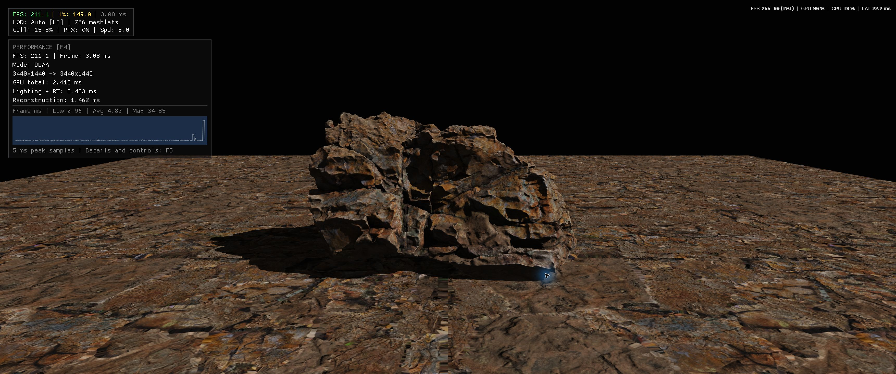

# VK Game Engine

A Vulkan 1.3 experimental rendering engine written in C++20, implementing a modern GPU-driven pipeline with mesh shaders, visibility buffer shading, discrete meshlet LODs, and hierarchical-Z occlusion culling.

## Features

- **Visibility Buffer Shading**: Decouples geometry rasterization from material evaluation. The geometry pass rasterizes 64-bit IDs `(meshletIndex, primitiveID)` to an `R32G32_UINT` attachment. A fullscreen compute pass (`shaders/deferred.comp`) reconstructs screen-space barycentric coordinates and evaluates PBR materials only on visible pixels, avoiding redundant fragment shading on occluded surfaces.
- **Meshlet Pipeline**: Geometry is partitioned into meshlets (up to 64 vertices, 124 triangles) using `meshoptimizer` and rendered via Task and Mesh shaders (`VK_EXT_mesh_shader`).
- **GPU Culling & Indirect Dispatch**:
  - *Instance Pre-Cull (`shaders/cull.comp`)*: Evaluates bounding box frustum culling, calculates sub-pixel screen-space geometric surface error ($\le 1.0\text{ px}$ budget) to select the discrete LOD step, and writes indirect draw commands (`VkDrawMeshTasksIndirectCommandEXT`). Whole-object Hi-Z rejection is bypassed so it cannot discard meshlets before recovery.
  - *Meshlet Culling (`shaders/shader.task`)*: Evaluates frustum, cone backface and conservative reverse-Z Hi-Z tests. Unchanged views use one geometry pass; moving/jittered views predict against previous depth and recover deferred meshlets against current depth before shading. Odd-size pyramids retain complete source coverage, and F2 freezes paired depth/camera metadata. See [rendering architecture](docs/file.md).
- **Hardware Ray-Traced Shadows & Dynamic TLAS Pointer Swapping**: Exact directional shadows powered by physical GPU RT cores via `VK_KHR_acceleration_structure` and `VK_KHR_ray_query`. Integrates inline ray queries directly into the Visibility Buffer deferred resolve pass (`shaders/deferred.comp`), completely bypassing primary ray traversal and firing coherent shadow rays exclusively from visible surface pixels with normal-offset bias. Features dynamic per-frame TLAS pointer swapping that synchronizes the active BLAS geometry (`lodBlas[0..5]`) to the rasterized mesh LOD by default (with runtime toggle `Y` to switch between active visible LOD and ground-truth LOD 0), preventing self-shadowing acne and geometric mismatch.
- **Interactive Controls & Hotkeys**:
  - Hotkey `T` toggles hardware ray-traced shadows on and off; Hotkey `Y` toggles ray tracing against the active visible LOD (default) vs. ground-truth LOD 0; F5 diagnostics exposes interactive sun azimuth, elevation, intensity, and RT LOD mode controls.
  - Hotkeys `7`, `8`, `9` toggle Frustum, Cone, and Hi-Z culling stages independently at runtime with live atomic counters displayed on the HUD.
  - Hotkeys `0` (Auto) and `1`–`6` (Force LOD 0–5) provide instant runtime LOD inspection.
  - Hotkey `F1` / `M` toggles debug meshlet cluster coloring; `F2` freezes the culling camera for free-flight inspection.
  - Starting camera initializes at `(3.0, 1.0, 0.0)` aimed directly at the model's true 3D bounding box center.
- **6-Level Discrete Meshlet LODs with Sub-Pixel Error**: Generates 6 progressive simplification steps (100%, 50%, 25%, 12.5%, 6.25%, 3.125%) with cumulative 3D geometric surface deviation in meters (`meshopt_simplifyScale`) embedded in the header to guarantee sub-pixel geometric accuracy across distances.
- **Bindless Descriptors**: Uses Vulkan descriptor indexing for texture arrays, a global material SSBO and a scene TLAS descriptor. Shaders index material/textures without per-texture draw bindings; geometry still uses per-model descriptor sets.
- **Offline Asset Compiler**: Standalone tool (`tools/model_compiler.cpp`) using `fastgltf` and `tinyobjloader` to process `.gltf` and `.obj` assets into binary `.glb` files with embedded meshlet streams, discrete LOD levels, and pre-compressed KTX2 textures (BC7 for albedo/normals, BC5 for roughness/metallic) packed directly into GLB `BufferView` chunks.
- **Virtual File System (VFS)**: Packages SPIR-V shaders, models, and textures into a single archive (`engine.pak`) accessed via memory-mapping on Windows, with automatic disk fallback for loose files during development.
- **PBR Shading**: Evaluates Cook-Torrance BRDF (Albedo, Normal, Metallic, Roughness) with material parameters fetched from a global SSBO and modulated by ray-traced shadow occlusion.
- **Temporal HDR Foundation & DLAA/DLSS**: Separate internal/output resolutions, linear HDR lighting, camera/object motion vectors and history validation support fixed model K DLAA and DLSS Quality/Balanced/Performance through Streamline 2.14.16. Native is the first-launch rendering default and has no temporal color accumulation. Missing or unsupported NVIDIA reconstruction falls back to Native. See [rendering architecture and verification limits](docs/file.md).
- **Reflex & Presentation Controls**: Independent NVIDIA Reflex Off / On / On + Boost, with effective status and driver timing in F5. Settings offers Mailbox (default), Immediate and VSync (FIFO). Reflex operation has been exercised; a latency improvement on the current scene has not been established.
- **Hardware Texture Mipmapping & Analytical Derivatives**: Closed-form screen-space barycentric derivatives (`dUVdx`, `dUVdy`) drive hardware `textureGrad` sampling for smooth, zero-pop anisotropic mipmap transitions.
- **Non-Intrusive Telemetry HUD & Profiler**: Passive F3 HUD, compact F4 performance overlay with a stable 5ms peak time-slot frame-time graph, reconstruction mode/dimensions and key GPU timings, and an independent F5 inspector for temporal, RT/lighting, culling, Reflex and detailed timing diagnostics. CPU frame time, GPU time and driver-reported latency are labeled separately.
- **Scalar Block Layout**: Uses `GL_EXT_scalar_block_layout` so C++ structs and shader storage buffers share matching memory layout without manual alignment padding.

## Roadmap & Upcoming Features

**Phase 4.1 is closed with its implemented temporal, DLAA/DLSS and Reflex foundation recorded.** Its unfinished scene, validation and distribution work is now part of Phase 5; closure does not imply those checks passed.

Phase 5 covers:

1. **Scene materials and emissive area lighting**: Correct per-surface material lookup, emissive materials, efficient light sampling and reusable lighting functions for ReSTIR DI.
2. **Cornell box, Crytek Sponza and scene selection**: A measured Cornell reference with a rectangular ceiling emitter, a complex multi-material scene, and runtime scene/camera selection.
3. **ReSTIR DI and SVGF**: Reservoir-based temporal/spatial direct-light sampling and denoising of stochastic direct illumination.
4. **Carried-over validation and distribution**: Image-quality review, memory soak, current Reflex measurements, remaining resource checks and NVIDIA runtime packaging.

Multi-bounce global illumination and color bleeding are outside Phase 5. The boulder is currently the only integrated demo scene; emissive area lighting, ReSTIR DI and SVGF are planned features.

Check out the [full roadmap](docs/roadmap.md) for detailed progress and upcoming milestones.

## Code Architecture

For a complete breakdown of every directory, component, and the GPU pipeline flow, see the [File Architecture Documentation](docs/file.md).

> **Visualizing the Engine:** We also have an interactive Mermaid.js diagram showing exactly how data moves from CPU to GPU. Check out the **[Pipeline Flowchart](docs/flow.md)**.
>
> *Note: When viewing the chart on GitHub, be sure to click the **Fullscreen button** (the expanding arrows icon in the top right of the diagram box) so you can easily read the nodes and use the view controls.*

## Images

## Release Downloads

The Phase 4 [**v0.2.0 portable release**](https://github.com/maksim-sterkis/MaksimEngine-Showcase/releases/tag/v0.2.0) is available for Windows 64-bit. Download `MaksimEngine-v0.2.0-Portable.zip`, extract, and launch `VK_game_engine.exe`.

That release predates the Phase 4.1 temporal/NVIDIA integration. Current development uses MinGW Debug; CMake stages the NVIDIA DLLs and notices beside the executable. Updating portable packaging and verifying the resulting runtime on a clean machine remain Phase 5 work.

## Credits & Dependencies
- [Vulkan](https://www.vulkan.org/)
- [fastgltf](https://github.com/spnda/fastgltf)
- [tinyobjloader](https://github.com/tinyobjloader/tinyobjloader)
- [meshoptimizer](https://github.com/zeux/meshoptimizer)
- [stb_image](https://github.com/nothings/stb)
- [GLFW](https://www.glfw.org/)
- [GLM](https://github.com/g-truc/glm)
- [Dear ImGui](https://github.com/ocornut/imgui)
- [NVIDIA Streamline](https://github.com/NVIDIA-RTX/Streamline) (DLAA/DLSS, Reflex and PC Latency Stats)
