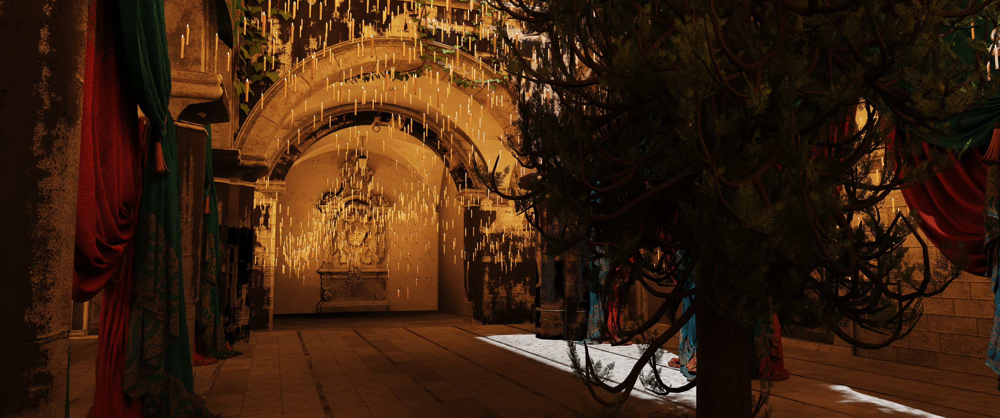

# VK Game Engine

  
  
   
  
  

  Intel New Sponza (2022) — all add-ons + 10k candle point lights, DLSS 4.5 Ray Reconstruction Quality (3440×1440, spatial upscaling off) · <a href="docs/5.1/5.1-images.md">View full Phase 5.1 photo collection →</a>

A Vulkan 1.3 experimental rendering engine written in C++20, implementing a modern GPU-driven pipeline with mesh shaders, visibility buffer shading, discrete meshlet LODs, and hierarchical-Z occlusion culling.

## Features

- **Visibility Buffer Shading**: Decouples geometry rasterization from material evaluation. The geometry pass writes a meshlet index and packed instance/triangle index into a 64-bit `R32G32_UINT` attachment. Compute shading reconstructs barycentrics and UV gradients, then resolves the model, surface and global material through ownership tables. Opaque instances share models while retaining independent transforms and LODs.
- **Meshlet Pipeline**: Geometry is partitioned into meshlets (up to 64 vertices, 124 triangles) using `meshoptimizer` and rendered via Task and Mesh shaders (`VK_EXT_mesh_shader`).
- **GPU Culling & Indirect Dispatch**:
  - *Instance Pre-Cull (`shaders/cull.comp`)*: Evaluates bounding box frustum culling, calculates sub-pixel screen-space geometric surface error ($\le 1.0\text{ px}$ budget) to select the discrete LOD step, and writes indirect draw commands (`VkDrawMeshTasksIndirectCommandEXT`). Whole-object Hi-Z rejection is bypassed so it cannot discard meshlets before recovery.
  - *Meshlet Culling (`shaders/shader.task`)*: Evaluates frustum, cone backface and conservative reverse-Z Hi-Z tests. Unchanged views use one geometry pass; moving/jittered views predict against previous depth and recover deferred meshlets against current depth before shading. Odd-size pyramids retain complete source coverage, and F2 freezes paired depth/camera metadata. See [rendering architecture](docs/file.md).
- **Hardware Ray-Traced Shadows & Dynamic TLAS Pointer Swapping**: Exact directional shadows powered by physical GPU RT cores via `VK_KHR_acceleration_structure` and `VK_KHR_ray_query`. Integrates inline ray queries directly into the Visibility Buffer deferred resolve pass (`shaders/deferred.comp`), completely bypassing primary ray traversal and firing coherent shadow rays exclusively from visible surface pixels with normal-offset bias. Features dynamic per-frame TLAS pointer swapping that synchronizes the active BLAS geometry (`lodBlas[0..5]`) to the rasterized mesh LOD by default (with runtime toggle `Y` to switch between active visible LOD and ground-truth LOD 0), preventing self-shadowing acne and geometric mismatch.
- **Interactive Controls & Hotkeys**:
  - Hotkey `T` toggles hardware ray-traced shadows on and off; Hotkey `Y` toggles ray tracing against the active visible LOD (default) vs. ground-truth LOD 0; F5 diagnostics exposes interactive sun azimuth, elevation, intensity, and RT LOD mode controls.
  - Hotkeys `7`, `8`, `9` toggle Frustum, Cone, and Hi-Z culling stages independently at runtime with live atomic counters displayed on the HUD.
  - Hotkeys `0` (Auto) and `1`–`6` (Force LOD 0–5) provide instant runtime LOD inspection.
  - Hotkey `F1` / `M` toggles debug meshlet cluster coloring; `F2` freezes the culling camera for free-flight inspection.
  - Starting camera initializes at `(3.0, 1.0, 0.0)` aimed directly at the model's true 3D bounding box center.
- **Six Discrete Meshlet LODs**: MLOD v2 simplifies each source primitive independently toward progressively lower triangle budgets, preserving surface/material boundaries and static demo ground. Locked boundaries can limit reduction. Each LOD records the maximum primitive error; runtime selection uses a one-pixel projected-error budget.
- **Bindless Descriptors**: Uses Vulkan descriptor indexing for texture arrays, a global material SSBO and a scene TLAS descriptor. Shaders index material/textures without per-texture draw bindings; geometry still uses per-model descriptor sets.
- **Offline Asset Compiler**: Standalone tool (`tools/model_compiler.cpp`) using `fastgltf` and `tinyobjloader` to process `.gltf` and `.obj` assets into binary `.glb` files with embedded meshlet streams, discrete LOD levels, and pre-compressed KTX2 textures (BC7 for albedo/normals, BC5 for roughness/metallic) packed directly into GLB `BufferView` chunks.
- **Virtual File System (VFS)**: Packages SPIR-V shaders, models, and textures into a single archive (`engine.pak`) accessed via memory-mapping on Windows, with automatic disk fallback for loose files during development.
- **PBR, Emissive & Two-Room Direct Lighting**: Cook-Torrance materials use albedo, normals, metallic and roughness. The startup Boulder scene retains directional lighting; the Esc scene selector adds both the original **Lighting Sandbox** (`3` and `64` one-sided emissive triangle lights) and **Lighting Sandbox (two rooms)** (roofed area-lit room connected by a doorway to a roofless courtyard with three rock-only Boulder instances and a togglable `0.53°` solar-disk directional sun). Conventional sampling and ReSTIR DI are selectable, with an independent 4096-spp direct-light reference and an output-resolution emitter presentation pass (`present_emitters.comp.spv`).
- **Temporal HDR Foundation, DLAA/DLSS, Ray Reconstruction & Spatial Scaling**: Separate internal/output resolutions, linear HDR lighting, camera/object motion vectors and history validation support fixed model K DLAA and DLSS Quality/Balanced/Performance plus optional **DLSS 4.5 Ray Reconstruction** (`preset F`, `DLAA` through `Ultra Performance`) through Streamline `2.14.16` / NGX `310.9.16`, with demand-driven RR guides and 4-estimate decorrelated final shading. **Reconstruction scale** (`Off (100%)`, `85%`, `75%`, `67%`, `50%`) decouples temporal reconstruction from display resolution and upscales to swapchain via **AMD FidelityFX EASU + optional RCAS** sharpening or **Bilinear** (`Off (100%)` releases all spatial GPU resources and adds zero pass overhead), paired with a non-hardcoded live **Recommend...** advisor in Settings. Native is the first-launch rendering default and has no temporal color accumulation. Missing or unsupported NVIDIA reconstruction falls back to Native (RR modes stop with an explicit error on failure). See [rendering architecture and verification limits](docs/file.md).
- **Real-Time Denoising (NVIDIA NRD)**: Statically integrates **NVIDIA Real-Time Denoisers (`NRD v4.18.0`)** natively on Vulkan (no NRI, zero extra runtime DLLs) for lightweight compute denoising across non-RR paths: **NRD RELAX** (primary ReSTIR/emissive denoiser with 4-estimate fresh RIS shading) and **NRD REBLUR**. Persistent `Denoiser` settings (`Off`, `NRD RELAX`, `NRD REBLUR`) remain mutually exclusive with DLSS Ray Reconstruction and free all NRD pools (`0 MiB`) when inactive.
- **Reflex & Presentation Controls**: Independent NVIDIA Reflex Off / On / On + Boost, with effective status and driver timing in F5. Settings offers Mailbox (default), Immediate and VSync (FIFO) with live switching and no restart required. On Win32 NVIDIA Mailbox swapchains, `VK_FULL_SCREEN_EXCLUSIVE_DISALLOWED_EXT` and pre-present fence synchronization address tearing and VBlank stalls. Reflex operation has been exercised; a latency improvement on the current scene has not been established.
- **Hardware Texture Mipmapping & Analytical Derivatives**: Closed-form screen-space barycentric derivatives (`dUVdx`, `dUVdy`) drive hardware `textureGrad` sampling for smooth, zero-pop anisotropic mipmap transitions.
- **Non-Intrusive Telemetry HUD & Profiler**: Passive F3 HUD, compact F4 performance overlay with a stable 5ms peak time-slot frame-time graph, reconstruction/denoiser mode, dimensions, live OS/GPU hardware telemetry (RAM, `VK_EXT_memory_budget` VRAM, NVML/NVAPI clocks/temps/power) and key GPU timings (including `denoiserMs`), plus an independent F5 inspector for temporal, NRD/RR, RT/lighting, culling, Reflex and detailed timing diagnostics. CPU frame time, GPU time and driver-reported latency are labeled separately.
- **Scalar Block Layout**: Uses `GL_EXT_scalar_block_layout` so C++ structs and shader storage buffers share matching memory layout without manual alignment padding.

## Roadmap & Upcoming Features

**Phase 5 is complete (`v0.3.0`, November 14, 2026).** Phase 4.1's temporal, DLAA/DLSS and Reflex foundation is retained, and Phase 5 ships opaque instances, emissive triangle lighting, initial RIS candidates, temporal/spatial ReSTIR DI reuse, fresh final visibility, emission payload caching and 48-byte packed cached surfaces. See [implementation and verification limits](docs/file.md#verification-and-limits).

Phase 5 covers:

1. **Scene materials and emissive area lighting**: Correct per-surface material lookup, emissive materials, emission payload caching in light records, efficient light sampling and reusable lighting functions for ReSTIR DI.
2. **Controlled lighting sandbox and reference**: Few/many-light presets (`3` and `64` emitters), opaque objects, dynamic motion cases and an unjittered Native 4096-spp direct-light reference.
3. **ReSTIR DI**: Basic real-time correction (`4` initial candidates, `1` spatial proposal, scalar stable-history and fused initial/temporal/spatial/shading kernels) and a ray-traced reference policy. Final spatial reservoirs feed next-frame history by default; a temporal-only history comparison and Conventional MC remain selectable in F5.
4. **Validation & sustained benchmarks**:
   - All 11 CPU/offline `ctest` suites, all 15 `spirv-val` Vulkan 1.3 validations, forced Vulkan synchronization validation (`ReSTIR4` Basic Full DI), full-res `3440x1440` Jitter regression, and full-res `3440x1440` dynamic/disocclusion Motion Quality audits (`ReSTIR4` vs. `ReSTIR8`, including `7,016` revealed receiver pixels) pass.
   - **Sustained `3440x1440` Mailbox benchmarks (RTX 3090, Nov 12, 30 runs / 226,201 frames)**: `Sandbox64Interior` averaged **174.3–174.5 FPS DLAA** (`4.82–4.84 ms` GPU), **250.9–251.1 FPS DLSS Quality** (`3.07 ms` GPU), and **267.4–268.3 FPS Native** (`2.85 ms` GPU), while `Boulder` exceeded **320 FPS DLAA** (`322.9–341.8 FPS`).
   - **Equal-cost multi-view audits (48B packed build, `3440x1440`)**: `MC7` (`2.61 ms` lighting) and `MC8` (`2.87 ms`) bracket `ReSTIR4` (`2.68 ms`). Across 16 independent trajectories × 256 frames vs. `MC8`, `ReSTIR4` delivers **37.2% lower raw RGB MSE** and **77.9% lower raw luminance MSE** in `Sandbox64Interior`, and **42.3% lower raw luminance MSE** in `Sandbox64Exterior` (while `MC8` leads in the 3-emitter interior where sample count exceeds triangle count).

**Phase 5.1 is complete (`v0.3.1`, November 25, 2026)** on top of the Phase 5 (`v0.3.0`) direct-lighting baseline:
- **Delivered**: Optional **DLSS 4.5 Ray Reconstruction** (`preset F`, `DLAA`..`Ultra Performance`) evaluation and denoiser policy; native Vulkan **NVIDIA NRD (`v4.18.0`: `RELAX`, `REBLUR`)** compute denoisers (`34.34 dB` static PSNR in `9.97 ms` GPU Native / `6.10 ms` GPU with DLSS Quality on `Sandbox64`); **Lighting Sandbox (two rooms)** with three courtyard Boulder instances, a togglable `0.53°` directional sun, and four Phase 6 baseline captures; output-resolution emitter resolve (`present_emitters.comp.spv`); independent **DLSS reconstruction scale (`Off (100%)`..`50%`) + EASU/RCAS spatial upscaling + live Advisor**; the Win32 NVIDIA Mailbox presentation pacing fix (`VK_EXT_present_timing` audited `0` stalls; a 200 FPS cap reported under some configurations remains deferred); and the `v0.3.1` portable release.
- **Cornell Box** is available in the Esc scene selector with Cornell's measured two-block geometry, camera, and rectangular ceiling emitter.
- **Intel New Sponza (2022)** adds six authored camera presets, independently toggleable Colorful Curtains, Ivy, Trees, and Emissive Candles, plus a separate candle point-light switch. [Scene assets and benchmarks](docs/5.1/new-sponza.md) · [Phase 5.1 photo collection](docs/5.1/5.1-images.md)
- **Next**: **Phase 6** will introduce ReSTIR GI (followed by **Phase 6.1** for dynamic LOD/RT/meshlet temporal stability). Lighting remains direct only, and custom SVGF stays deferred in favor of NRD.

Check out the [full roadmap](docs/roadmap.md) for detailed progress and upcoming milestones.

## Code Architecture

For a complete breakdown of every directory, component, and the GPU pipeline flow, see the [File Architecture Documentation](docs/file.md).

> **Visualizing the Engine:** We also have an interactive Mermaid.js diagram showing exactly how data moves from CPU to GPU. Check out the **[Pipeline Flowchart](docs/flow.md)**.
>
> *Note: When viewing the chart on GitHub, be sure to click the **Fullscreen button** (the expanding arrows icon in the top right of the diagram box) so you can easily read the nodes and use the view controls.*

## Release Downloads

The latest packaged release is [**MaksimEngine v0.3.1**](https://github.com/maksim-sterkis/MaksimEngine-Showcase/releases/tag/v0.3.1), dated November 25, 2026, for Windows 10/11 64-bit. Download [MaksimEngine-v0.3.1-Portable.zip](https://github.com/maksim-sterkis/MaksimEngine-Showcase/releases/download/v0.3.1/MaksimEngine-v0.3.1-Portable.zip) (`75.66 MB`), extract it into a writable folder keeping all files and folders together, and launch `VK_game_engine.exe`.

The v0.3.1 portable build (`VKE_BUILD_TESTS=OFF`, `NDEBUG`, stripped `12.04 MB` Release binary + `34.53 MB` `engine.pak`) includes:
- Startup **Boulder** scene with meshlet LODs, conservative Hi-Z culling, and hardware ray-traced directional shadows.
- **Esc scene selector**: **Lighting Sandbox** (`3` and `64` emissive lights, `ReSTIR DI` and `Conventional MC`, dynamic motion toggles, `4096-spp` reference), **Lighting Sandbox (two rooms)** (with three courtyard Boulder instances and togglable `0.53°` directional sun), and **Cornell Box**. *(Intel New Sponza 2022 is auto-discovered if imported under `assets/models/sponza/` and is omitted from the portable ZIP due to its ~2.66 GB compiled asset size.)*
- NVIDIA **model K DLAA / DLSS Super Resolution**, optional **DLSS 4.5 Ray Reconstruction** (`preset F`, `sl.dlss_d.dll` + `nvngx_dlssd.dll`), **NVIDIA Reflex** Off / On / On + Boost, statically linked **NVIDIA NRD (`v4.18.0`: `RELAX`, `REBLUR`)**, independent **Reconstruction scale + EASU/RCAS Spatial Upscaling + live Advisor**, output-resolution emitter resolve, Win32 Mailbox pacing fix, tabbed **Settings** / collapsed **F5** diagnostics, `nvidia-notices/` (including `nrd-license.txt`), and Microsoft VC++ runtime DLLs. Native is the first-launch default; DLAA/DLSS/RR require a supported NVIDIA RTX GPU and compatible driver.

Local RTX 3090 verification for v0.3.1 covers Release (`VKE_BUILD_TESTS=OFF`) compilation with zero external MinGW DLL dependencies, `engine.pak` archive creation (`35` files: `24` SPIR-V shaders, `10` GLBs, `1` KTX2), and `12/12` `ctest` + `24` engine / `159` NRD `spirv-val` + forced-validation GPU checks on the same codebase. Verification covers the local RTX 3090 Windows development environment; non-development clean-machine and multi-GPU/driver testing are tracked in [future work](docs/planning/future-work.md).

## Credits & Dependencies
- [Vulkan](https://www.vulkan.org/)
- [fastgltf](https://github.com/spnda/fastgltf)
- [tinyobjloader](https://github.com/tinyobjloader/tinyobjloader)
- [meshoptimizer](https://github.com/zeux/meshoptimizer)
- [stb_image](https://github.com/nothings/stb)
- [GLFW](https://www.glfw.org/)
- [GLM](https://github.com/g-truc/glm)
- [Dear ImGui](https://github.com/ocornut/imgui)
- [NVIDIA Streamline](https://github.com/NVIDIA-RTX/Streamline) (DLAA/DLSS, DLSS 4.5 Ray Reconstruction, Reflex and PC Latency Stats)
- [NVIDIA Real-Time Denoisers (NRD)](https://github.com/NVIDIAGameWorks/RayTracingDenoiser) (`RELAX`, `REBLUR`)
