# Phase 5.1 Integration Validation & Sponza Optimization Report

**Date:** 2026-11-24 *(Task 7 audit; Task 8 spatial upscaling/`24/24` SPIR-V/SIGMA removal and Task 9 `v0.3.1` packaging subsequently closed Phase 5.1 on 2026-11-25)*

**Hardware / OS Baseline:** NVIDIA GeForce RTX 3090 (24 GiB VRAM), Windows, 3440×1440 (21:9 ultrawide), Release build with Force LOD 0 active (`manual_lod_override = 0`; dynamic LOD stability deferred to [Phase 6.1](../planning/future-work.md#force-lod-0-default--dynamic-lod-temporal-stability-deferred-to-phase-61)).

---

## 1. Intel New Sponza (`3440×1440`, All Add-ons + 10k Point Lights, LOD 0)

Every benchmark below renders all 5 Sponza packages (**Base + Curtains + Ivy + Trees + Candles**: `10,149` instances, `32,373,689` LOD 0 triangles, `8,098` emissive area triangles + `10,000` punctual candle point lights, **Force LOD 0**) over 32 steady static frames (`step 16..47`) and 48 camera-pan frames (`step 48..95`) without disk-capture overhead.

### 1.1 Baseline vs. Final Summary (Static / Pan Averages)

| Mode | Present Mode | Internal Res | Baseline GPU (ms / FPS) | Final GPU (ms / FPS) | Final Wall (ms / FPS) | Wall − GPU (ms) | Process VRAM (MiB) |
| :--- | :--- | --- | ---: | ---: | ---: | ---: | ---: |
| **RR Balanced** | Mailbox | 1995×835 | 19.269 / 51.9 FPS (pan 18.809 / 53.2) | **12.763 / 78.4 FPS** (pan **12.831 / 77.9**) | **14.508 / 68.9 FPS** (pan **14.494 / 69.0**) | 1.745 / 1.663 | 5,066 |
| **RR Balanced** | Immediate | 1995×835 | — | **12.933 / 77.3 FPS** (pan **12.943 / 77.3**) | **13.724 / 72.9 FPS** (pan **13.975 / 71.6**) | **0.792 / 1.032** | 5,066 |
| **RR Performance** | Mailbox | 1720×720 | 15.148 / 66.0 FPS (pan 14.796 / 67.6) | **10.012 / 99.9 FPS** (pan **9.865 / 101.4**) | **11.779 / 84.9 FPS** (pan **11.452 / 87.3**) | 1.767 / 1.587 | 4,841 |
| **RR Quality** | Mailbox | 2293×960 | 23.861 / 41.9 FPS (pan 23.500 / 42.6) | **15.485 / 64.6 FPS** (pan **15.767 / 63.4**) | **17.248 / 58.0 FPS** (pan **17.441 / 57.3**) | 1.763 / 1.674 | 5,330 |
| **DLSS Quality + RELAX** | Mailbox | 2293×960 | 12.518 / 79.9 FPS (pan 12.553 / 79.7) | **10.609 / 94.3 FPS** (pan **10.779 / 92.8**) | **12.267 / 81.5 FPS** (pan **12.381 / 80.8**) | 1.659 / 1.602 | 4,901 |
| **DLSS Quality + REBLUR** | Mailbox | 2293×960 | 12.426 / 80.5 FPS (pan 12.079 / 82.8) | **10.392 / 96.2 FPS** (pan **10.163 / 98.4**) | **12.322 / 81.2 FPS** (pan **11.722 / 85.3**) | 1.930 / 1.559 | 4,879 |
| **Native (ReSTIR DI)** | Mailbox | 3440×1440 | — | **13.685 / 73.1 FPS** (pan **14.502 / 69.0**) | **15.275 / 65.5 FPS** (pan **15.880 / 63.0**) | 1.590 / 1.378 | 5,145 |

*Baseline wall-clock reference (`RR Balanced`, no captures): `22.358 ms` (`44.7 FPS`) static / `25.371 ms` (`39.4 FPS`) pan. Final `RR Balanced` non-SDK GPU work (`gpu − recon`) is **`5.095 ms`** static / **`5.130 ms`** pan.*

### 1.2 Per-Pass GPU Breakdown (Static / Pan Averages in ms)

| Mode | `geometry` | `cull + TLAS` | `initial` | `spatial + shade` | `NRD` | `recon` | `present` |
| :--- | ---: | ---: | ---: | ---: | ---: | ---: | ---: |
| **RR Balanced (Mailbox)** | 1.479 / 1.537 | **0.016 / 0.015** | 1.500 / 1.472 | **1.781 / 1.773** | 0.000 | 7.668 / 7.701 | 0.125 / 0.153 |
| **RR Balanced (Immediate)** | 1.609 / 1.563 | 0.016 / 0.015 | 1.530 / 1.530 | 1.724 / 1.764 | 0.000 | 7.726 / 7.756 | 0.102 / 0.149 |
| **RR Performance** | 1.398 / 1.263 | 0.016 / 0.015 | 1.148 / 1.083 | 1.314 / 1.294 | 0.000 | 5.833 / 5.914 | 0.137 / 0.136 |
| **RR Quality** | 1.511 / 1.734 | 0.017 / 0.015 | 1.814 / 1.832 | 2.231 / 2.285 | 0.000 | 9.602 / 9.618 | 0.140 / 0.118 |
| **DLSS Quality + RELAX** | 1.510 / 1.380 | 0.016 / 0.015 | 1.843 / 1.865 | 2.262 / 2.367 | **3.072 / 3.172** | 1.627 / 1.682 | 0.103 / 0.107 |
| **DLSS Quality + REBLUR** | 1.515 / 1.412 | 0.016 / 0.015 | 1.850 / 1.833 | 2.308 / 2.271 | **2.692 / 2.572** | 1.697 / 1.732 | 0.130 / 0.136 |
| **Native** | 1.577 / 1.790 | 0.016 / 0.014 | 5.237 / 5.818 | 6.620 / 6.542 | 0.000 | 0.001 / 0.006 | 0.099 / 0.102 |

### 1.3 Implemented Optimizations & Nsight Trace Findings

1. **Nsight Graphics (`ngfx-capture.exe`) & CPU Telemetry Findings:**
   - Wave 1 (`rr_balanced` baseline) suffered from forced `mip 0` sampling, host-visible GPU buffers, uncompacted RT BLASes, O(N) spatial-cell light scans, and `0.506 ms` redundant `cull + TLAS` rebuilds.
   - Wave 3 Nsight trace (`VK_game_engine_2026_11_24_21_01_53.ngfx-gputrace`) recorded `ReSTIR DI / Spatial reuse and shading` at `2.73–3.20 ms` (`nv.ngx.dlssd.Evaluate` `7.89–8.04 ms`, `SM active warps = 17.91%`, `warps inactive SM active = 45.43%`), guiding the Wave 4 single-dispatch spatial path and MIS target reuse (`spat` cut to **`1.724–1.781 ms`**).
2. **Candle BLAS Clustering vs. Instanced BLAS A/B (`10,000` candles, `RR Balanced`):**
   - Built optional `build_instanced_blas_clusters` (115 spatial candle clusters, `1124.18 -> 346.54 MiB` compacted BLAS) vs. keeping the single shared `candle.glb` BLAS instanced `10,000` times.
   - **Measured Result:** Keeping the single instanced candle BLAS **outperformed** 115 spatial clusters on `spatial + shade` (`1.742 ms` instanced vs `2.045 ms` clustered) while **saving `346.54 MiB` VRAM** because a single compact BLAS stays resident in GPU L1/L2 caches. Instanced candles are the default; `VKE_SPONZA_CLUSTER_CANDLES=1` retains the cluster builder for A/B testing.
3. **Engine, Ray Tracing & Shader Optimizations:**
   - **Pipeline & Memory (`src/renderer/`, `shaders/`):** Restored hardware mipmapping in `material_eval.glsl`; moved `instances`, `instanceBuffers`, and `indirectBuffers` to `DEVICE_LOCAL`; removed `occlusionMvp` from `InstanceGpu`; skipped unchanged static CPU uploads and 18k light hashes; added batch BLAS compaction and `VK_GEOMETRY_INSTANCE_FORCE_OPAQUE_BIT_KHR` on opaque instances; added opaque mesh shader (`shader_opaque.mesh.spv` with `-DVKE_OPAQUE_MESH=1`); added static Hi-Z instance culling (`cull.comp`), cached `cullHizSlots` / `frameTlasCache`, and gated recovery descriptor updates behind `if (predictive)` (`cull + TLAS`: `0.506 ms -> 0.015 ms`).
   - **ReSTIR DI (`src/renderer/restir_full.cpp`, `shaders/prepare_lights.comp`, `shaders/restir_*.comp`):** Replaced linear spatial-cell scanning for `lightCount > 256` with O(1) Vose Alias Tables (`GlobalAlias` + pre-baked `3×3×3` `LocalAlias` per `16×8×8` `GridCell`); added single-dispatch `restir_spatial_one.comp` (`1` neighbor for dense scenes, eliminating `offsets[9]` register pressure, extra dispatch, and barrier, plus `selectedDonor` MIS target reuse); kept `<= 256`-light scenes untouched.
   - **Present Overhead:** Mailbox pacing drain (`syncBeforeMailboxPresent`) + DWM composite accounts for `~1.66–1.76 ms` `wall − GPU` (`~1.0 ms` lower under `Immediate` tearing mode: `0.792–1.032 ms`, `72.9 FPS` wall on `RR Balanced`).

---

## 2. NRD Denoiser Quality & Temporal Stability

- **Fixes Applied (`shaders/restir_final.glsl`, `src/renderer/nrd_denoiser.cpp`):**
  - Switched dense (`> 256` lights) denoiser paths under RR, RELAX, and REBLUR to temporally decorrelated RIS draws (`1` ray/px, zero unoccluded `M=80` reservoir locking across 18,098 indoor candles that previously caused floor darkening and REBLUR surface mottling) while computing luminance-dominant `hitDist` for RELAX/REBLUR and tightening anti-firefly/lobe-clamping settings.
- **Visual & Quantitative Sign-Off (`build/sponza-final/`, `VKE_NRD_AUDIT=1`):**
  - Inspected `dlssq_relax-47.png`, `dlssq_relax-95.png`, `dlssq_reblur-47.png`, `dlssq_reblur-95.png`, and `rr_balanced-{47,95}.png`: zero fireflies, zero blur/smearing, zero floor darkening, zero REBLUR boiling/mottling, crisp foliage and fabric detail.
  - `VKE_NRD_AUDIT=1` (forced Vulkan + sync validation): `relax_native_3 psnr=42.4439 dB` (`rgbRMSE=0.002737`), `reblur_native_3 psnr=40.1818 dB` (`rgbRMSE=0.003501`), `sigma_native psnr=49.1917 dB`, `sigma_dlaa psnr=42.9299 dB`, `0` dynamic resets across `relax_native`, `reblur_native`, and `rr_dlaa`.

---

## 3. UI & Usability Overhaul

- **Style (`src/renderer/imgui.cpp`, `demo/main.cpp`):** Retained stock sharp-cornered ImGui dark styling (`ImGui::StyleColorsDark()`, no dimming overlay backdrop).
- **ESC Pause Menu (`demo/main.cpp`, `demo/sandbox.cpp`):** Cleanly proportioned dialog with centered `PAUSE` title, 2×2 Sponza add-on grid, and balanced `Resume` / `Settings` / `Quit` controls.
- **Settings Modal (`demo/main.cpp`):** Reorganized into 3 tabs (**Display**, **Upscaling & Denoising**, **Controls** with complete 12-row keybinding reference covering `W A S D`, `Space / Left Shift`, mouse look/wheel speed, `P`, `Esc`, `F1/M`, `F2`, `F3/F4/F5`, `T/Y`, `0(~)/1-6`, and `7/8/9`) plus a centered `Accept` / `Apply` / `Cancel` footer.
- **F5 Diagnostics (`demo/main.cpp`):** Enlarged default inspector (`460×560 * s`) and removed `ImGuiTreeNodeFlags_DefaultOpen` from **all** collapsible headers (`Reconstruction`, `Real-Time Denoiser (NRD)`, `Hardware & Memory`), so every F5 section starts cleanly collapsed.
- **Visual Check (`build/ui-captures/*.png`):** Verified all 6 rendered UI screenshots (`f5_collapsed.png`, `pause_menu.png`, `settings_display.png`, `settings_upscaling.png`, `settings_controls.png`, `exit_confirm.png`) at 3440×1440.

---

## 4. Phase 5.1 Task 7 Verification Matrix

### 4.1 Build, Unit Tests, Shaders & Forced Sync Validation (`RTX 3090`)

Every forced-validation check below ran with `VKE_FORCE_VALIDATION=1` and `VK_LAYER_VALIDATE_SYNC=1`. Pre-existing first-frame NVIDIA Streamline internal `nv.ngx.dlssd.resource` messages (observed inside `sl.dlss_d` since Task 1) are counted separately from engine-owned validation errors.

| Check | Configuration / Env | Exit | Engine Val Errors | `dlssd` Internal Blocks | Key Verified Result |
| :--- | :--- | ---: | ---: | ---: | :--- |
| **CTest Unit Suite** | `ctest --test-dir build/nsight-release` | 0 | N/A | N/A | All C++ unit targets passed |
| **SPIR-V Validation** | `spirv-val --target-env vulkan1.3` | 0 | 0 | 0 | `19/19` engine `.spv` modules valid |
| **Release No-Tests Build** | `VKE_BUILD_TESTS=OFF` (`build/release-notests`) | 0 | N/A | N/A | Clean `12,427,776 B` executable |
| **Two-Room Smoke** | `VKE_TWO_ROOM_SMOKE=1` + sync val | 0 | **0** | 0 | Sun doorway `0.1773`, wall `0`, penumbra `6/24 px` |
| **Cornell Box Audit** | `VKE_CORNELL_BOX_AUDIT=1` + sync val | 0 | **0** | 6 | `rr_dlaa` RMSE `0.01172`, lum PSNR `27.04 dB` |
| **Sandbox GPU Smoke** | `VKE_SANDBOX_GPU_SMOKE=1` + sync val | 0 | **0** | 0 | Exact IDs (`473,133` px), Hi-Z, 4096-spp ref |
| **ReSTIR Full Smoke** | `VKE_RESTIR_FULL_SMOKE=1` + sync val | 0 | **0** | 0 | Reprojection (`29,793` px), reuse, LOD/resize/cuts |
| **Temporal GPU Smoke** | `VKE_TEMPORAL_SMOKE=1` + sync val | 0 | **0** | 0 | LOD/res resets, 50% scale, letterbox, F2 recapture |
| **Hi-Z GPU Verify** | `VKE_HIZ_VERIFY=on` + sync val | 0 | **0** | 0 | CPU minima parity at `3440×1440`, `1001×777`, `751×583`, `501×389` |
| **NRD Smoke** | `VKE_NRD_SMOKE=1` + sync val | 0 | **0** | 2 | RELAX, RELAX+DLSS, REBLUR, RR excl (`0 MiB`), SIGMA |
| **NRD Quality Audit** | `VKE_NRD_AUDIT=1` + sync val (`3440×1440`) | 0 | **0** | 4 | RELAX3 `42.44 dB`, REBLUR3 `40.18 dB`, SIGMA `49.19 dB`, `0` resets |
| **Sponza Alpha + Transitions** | `VKE_SPONZA_BENCH=15` + `POINTS` + `ALPHA_AUDIT` + `TRANSITIONS` + sync val | 0 | **0** | 6 | Alpha `97.6%` match (`290,987` / `7,297`), resize, LOD 2, return to Boulder |
| **Reflex Smoke Matrix** | `VKE_REFLEX_SMOKE=1` + sync val | 0 | **0** | 0 | `15/15` `(Native/DLAA/DLSS × Off/On/Boost)` passed |
| **Missing DLSS Runtime** | `VKE_DLSS_SMOKE=1 VKE_DLSS_EXPECT_NATIVE=1 VKE_DLSS_DISABLE_RUNTIME=1` | 0 | **0** | 0 | Clean Native fallback (`evaluations=0`, delta `0`) |
| **Mailbox Cadence Audit** | `VKE_MAILBOX_CADENCE_AUDIT=1` (`3440×1440`) | 0 | **0** | 0 | Fixed Mailbox `99.98 dispFPS`, `0` tears, `0` stalls (incl. post-FIFO) |

### 4.2 Quantitative Memory Soak (`VKE_MEMORY_SOAK=1`, `3440×1440`)

Three consecutive full transition cycles: `Boulder -> Sandbox64 -> Sponza (all add-ons + points, RR Balanced) -> Add-ons Off -> Add-ons On + DLSS Quality + RELAX -> DLSS Quality + REBLUR -> Native + 1920×1080 resize -> 3440×1440 resize -> Boulder`.

| Cycle | Process VRAM (MiB) | RAM Working Set (MiB) | RAM Private Commit (MiB) |
| --- | ---: | ---: | ---: |
| Cycle 1 return | 5,688.07 | 926.03 | 6,458.23 |
| Cycle 2 return | 5,688.07 | 932.30 | 6,389.44 |
| Cycle 3 return | 5,688.07 | 930.12 | 6,462.24 |
| **Delta (Cycle 3 − Cycle 1)** | **0.00 MiB** | **+4.09 MiB** | **+4.00 MiB** |

### 4.3 NVIDIA Reflex Latency & Throughput Sweep (`VKE_REFLEX_BENCH=1`, `3440×1440`, `RR Balanced`)

| Scene | Reflex Mode | Measured FPS | GPU Frame (ms) | Wall Frame (ms) | Acquire (ms) | Sleep (ms) | Sim-to-GPU Latency (ms) |
| --- | --- | ---: | ---: | ---: | ---: | ---: | ---: |
| **Sponza** | Off | 70.29 | 12.750 | 14.226 | 0.011 | 0.041 | 28.798 |
| **Sponza** | On | 70.74 | 12.779 | 14.137 | 0.014 | 0.118 | 28.636 |
| **Sponza** | On + Boost | **70.90** | **12.733** | **14.105** | 0.011 | 0.104 | 28.755 |
| **Sandbox64** | Off | 97.57 | 8.888 | 10.248 | 0.012 | 0.033 | 25.478 |
| **Sandbox64** | On | 96.96 | 9.104 | 10.314 | 0.011 | 0.096 | **20.285** |
| **Sandbox64** | On + Boost | **99.54** | **8.743** | **10.046** | 0.012 | 0.082 | **19.239** |

On GPU-bound Sponza (`~70.3–70.9 FPS`), Reflex maintains throughput while shaving `~0.1–0.2 ms` `simToGpuMs`; on lighter `Sandbox64` (`~97–100 FPS`), Reflex cuts driver-reported simulation-to-GPU latency from **`25.48 ms` down to `19.24 ms` (`−24.5%`)**.

### 4.4 Visual Review & Open Coverage Limits

- **Inspected Scenes & Overlays:** Visually reviewed rendered PNG captures across **Boulder** (`sandbox-boulder.png`), **Lighting Sandbox 3 & 64** (`sandbox-few.png`, `sandbox-many.png`, `restir-full-reference.png`), **Two-Room Courtyard** (`two-room-sandbox.png`), **Intel New Sponza** (`rr_balanced`, `dlssq_relax`, `dlssq_reblur`), and all **UI views** (`f5_collapsed`, `pause_menu`, `settings_display`, `settings_upscaling`, `settings_controls`, `exit_confirm`).
- **Remaining Coverage Limits:** All Task 7 measurements ran locally on Windows with a single **NVIDIA GeForce RTX 3090** driver environment. Other GPU vendors/architectures (e.g., Turing/Ada/Blackwell, AMD RDNA, Intel Arc) and clean non-development Windows machines (including missing-runtime checks on a virgin OS image) are tracked as future verification in [future work](../planning/future-work.md#clean-machine--multi-gpudriver-verification).

---

## 5. Capture Gallery

### Sponza rendering

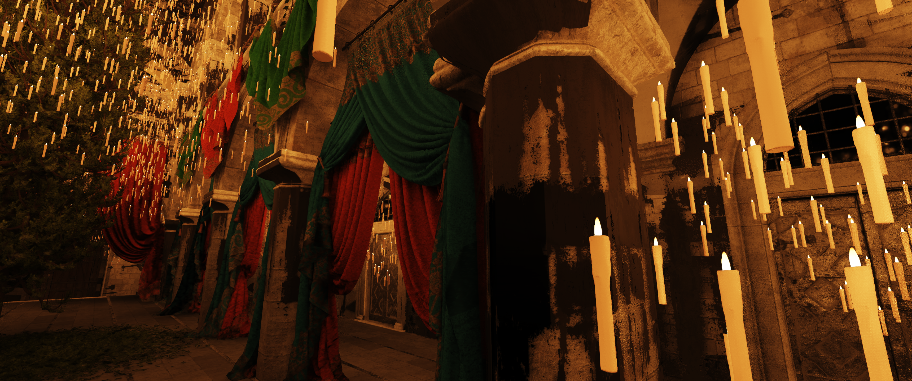

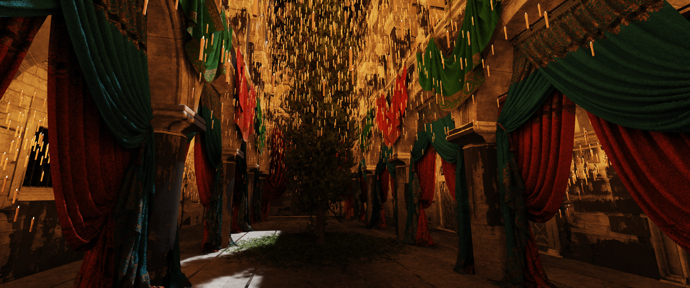

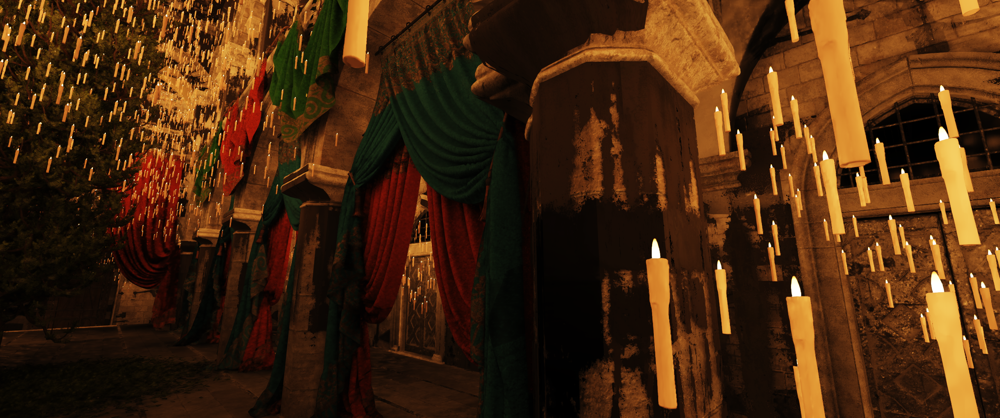

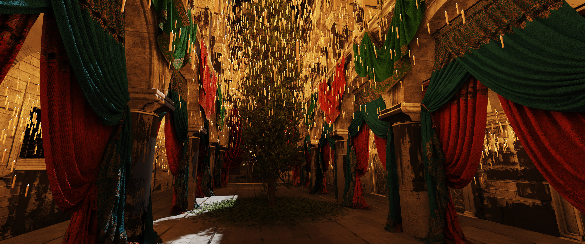

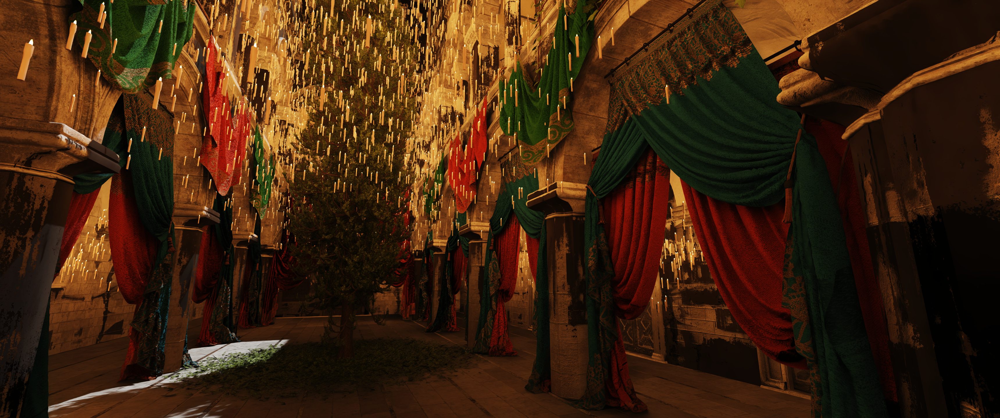

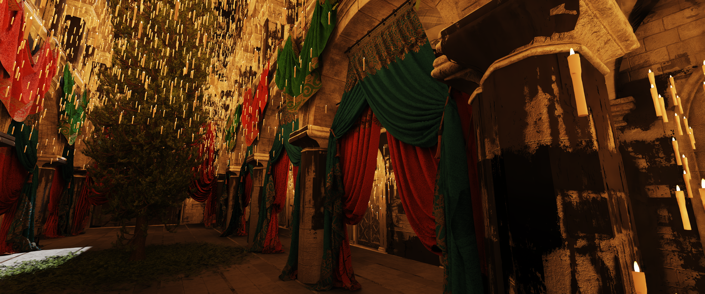

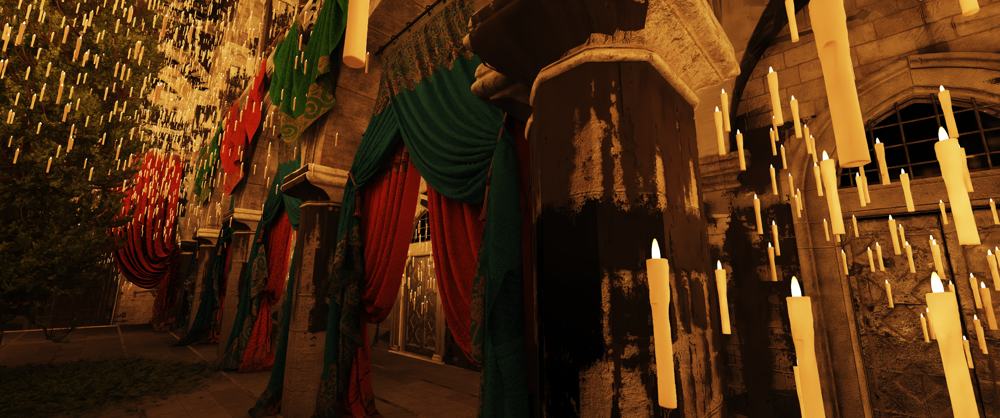

### UI states

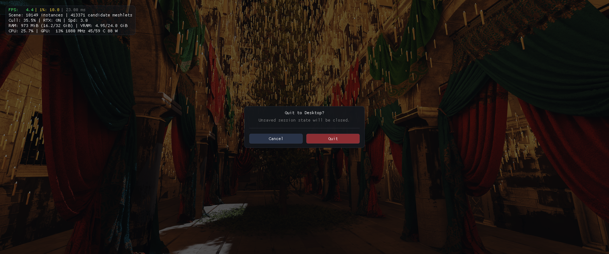

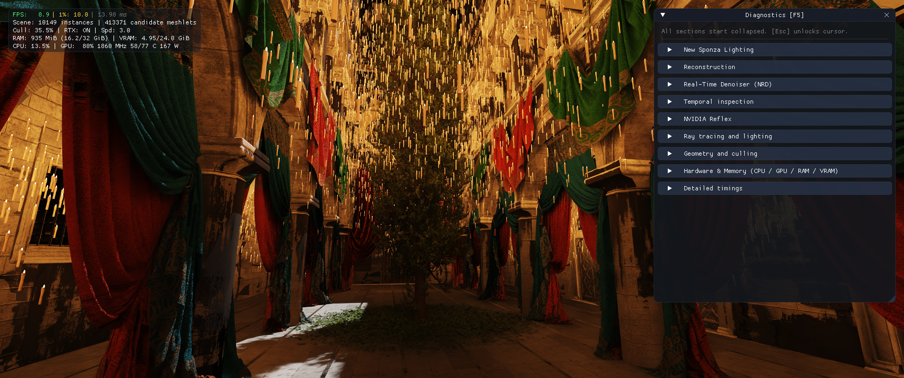

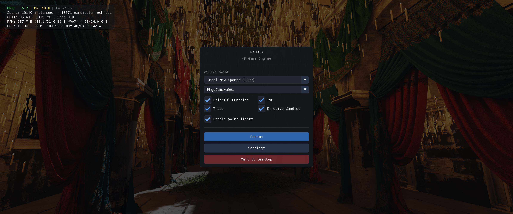

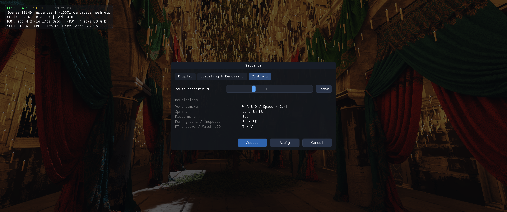

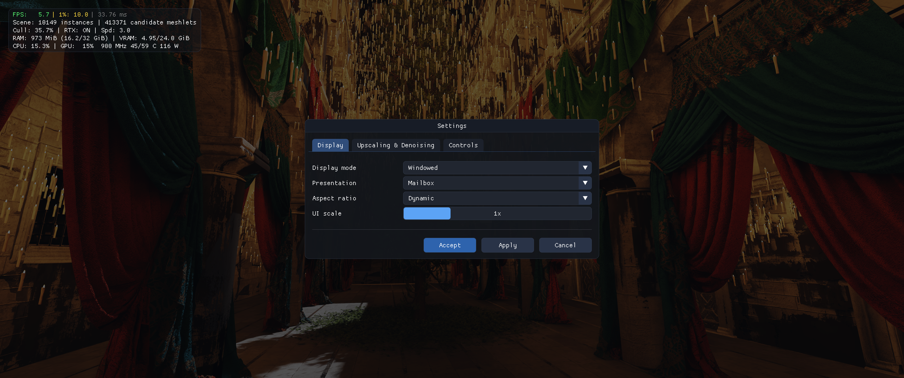

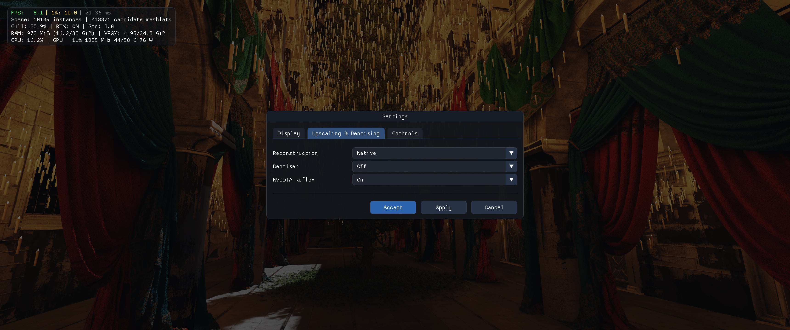

### Task 7 scenes

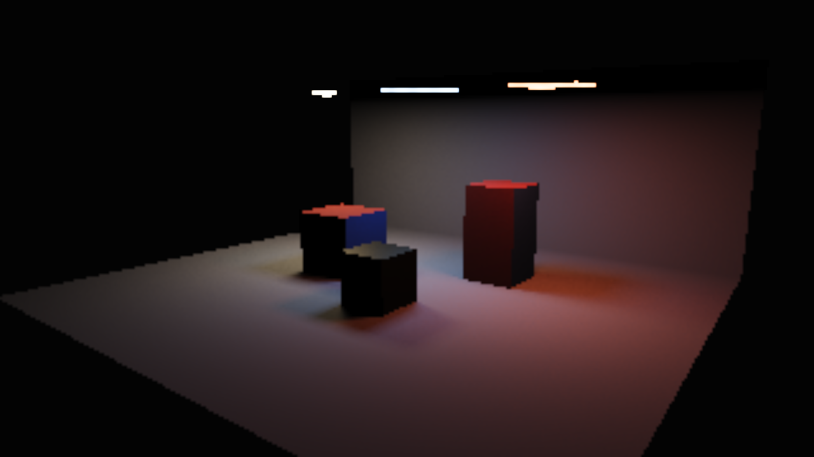

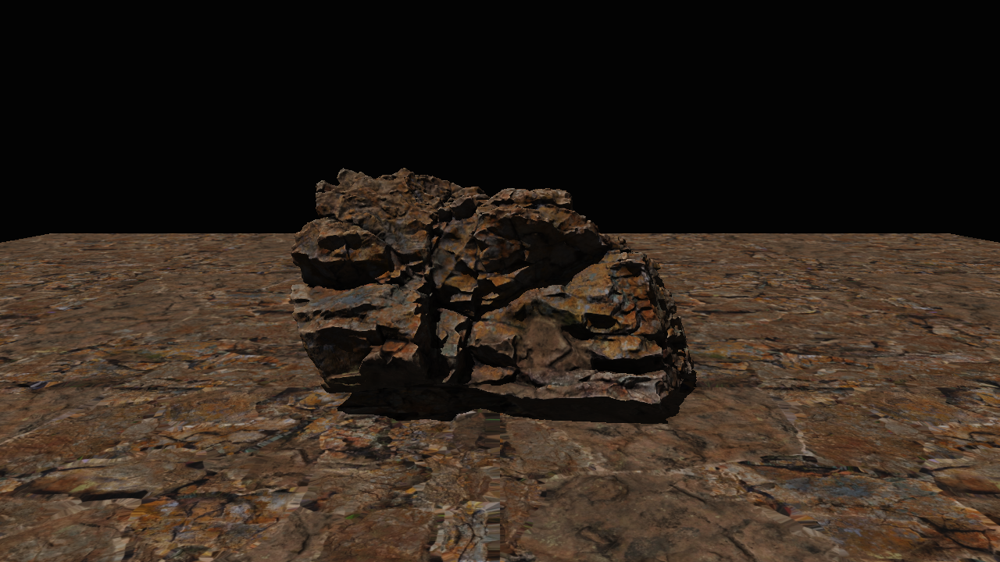

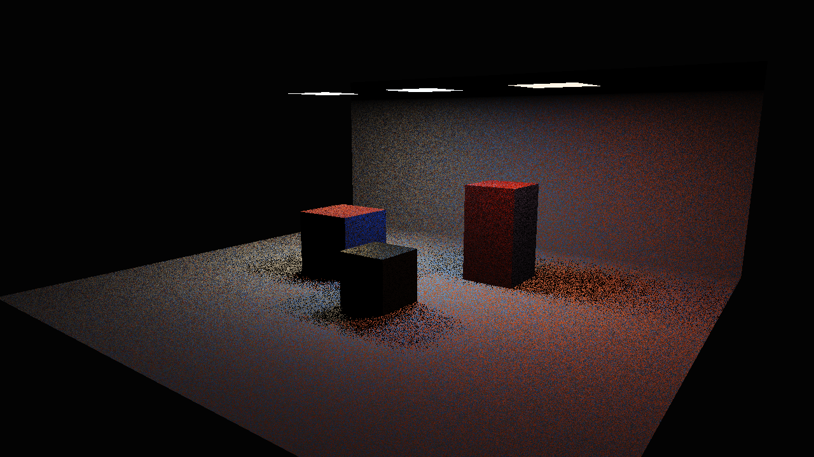

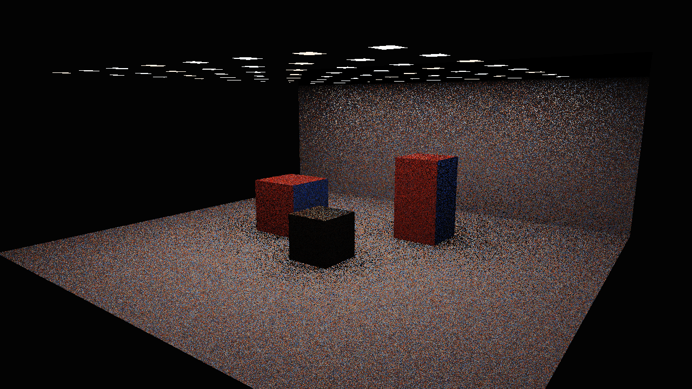

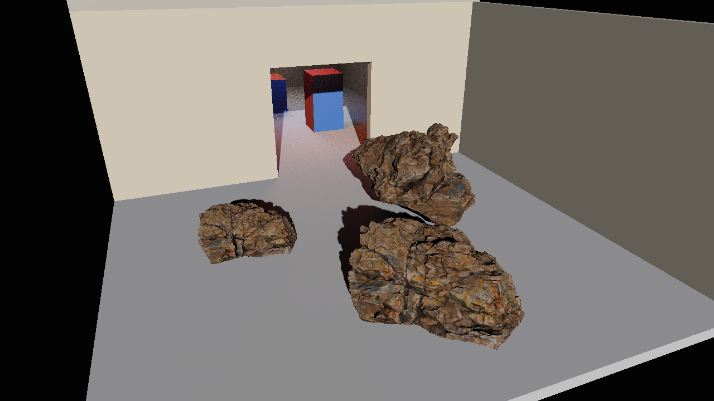

## v0.3.1 portable release refresh

- Both ZIPs were rebuilt with Windows Explorer-compatible paths and checked with the .NET ZIP reader and Windows Explorer. The standard archive contains 19 files and the Sponza archive contains 267. A full extraction check passed for the standard archive.
- The RTX 3090 Sponza run at 3440×1440 with all four add-ons, 10,000 candle points and RR Balanced measured process VRAM falling from 5,066 MiB to 3,533 MiB after the 2K texture cap and on-demand render allocations.
- The refresh passed 12/12 CTest suites, SPIR-V validation for compiled engine shaders, and forced Vulkan synchronization validation for Sponza RR Balanced, spatial upscaling and temporal smoke checks.
- The refreshed release also passed a manual RTX 5060 check at 4K. The figures above come from the RTX 3090 run.
