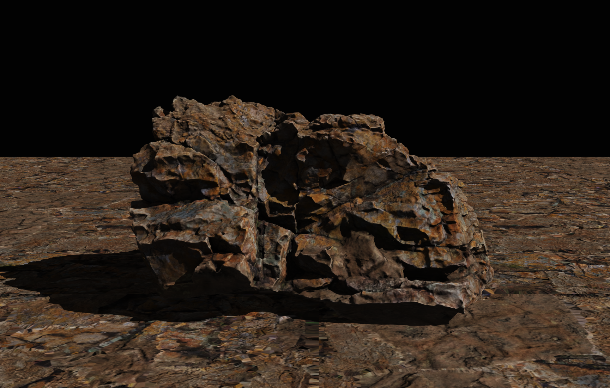
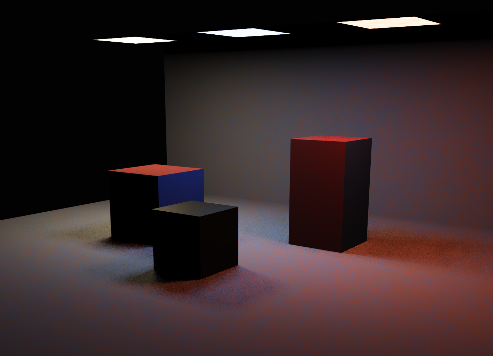

# Combined Engine Documentation

This archived snapshot combines the [README](../../README.md), [file architecture](../file.md), [pipeline flowchart](../flow.md), and [roadmap](../roadmap.md). Use those sources for current information.
<!-- Source: README.md -->

# VK Game Engine

  
  

A Vulkan 1.3 experimental rendering engine written in C++20, implementing a modern GPU-driven pipeline with mesh shaders, visibility buffer shading, discrete meshlet LODs, and hierarchical-Z occlusion culling.

## Features

- **Visibility Buffer Shading**: Decouples geometry rasterization from material evaluation. The geometry pass writes a meshlet index and packed instance/triangle index into a 64-bit `R32G32_UINT` attachment. Compute shading reconstructs barycentrics and UV gradients, then resolves the model, surface and global material through ownership tables. Opaque instances share models while retaining independent transforms and LODs.
- **Meshlet Pipeline**: Geometry is partitioned into meshlets (up to 64 vertices, 124 triangles) using `meshoptimizer` and rendered via Task and Mesh shaders (`VK_EXT_mesh_shader`).
- **GPU Culling & Indirect Dispatch**:
  - *Instance Pre-Cull (`shaders/cull.comp`)*: Evaluates bounding box frustum culling, calculates sub-pixel screen-space geometric surface error ($\le 1.0\text{ px}$ budget) to select the discrete LOD step, and writes indirect draw commands (`VkDrawMeshTasksIndirectCommandEXT`). Whole-object Hi-Z rejection is bypassed so it cannot discard meshlets before recovery.
  - *Meshlet Culling (`shaders/shader.task`)*: Evaluates frustum, cone backface and conservative reverse-Z Hi-Z tests. Unchanged views use one geometry pass; moving/jittered views predict against previous depth and recover deferred meshlets against current depth before shading. Odd-size pyramids retain complete source coverage, and F2 freezes paired depth/camera metadata. See [rendering architecture](../file.md).
- **Hardware Ray-Traced Shadows & Dynamic TLAS Pointer Swapping**: Exact directional shadows powered by physical GPU RT cores via `VK_KHR_acceleration_structure` and `VK_KHR_ray_query`. Integrates inline ray queries directly into the Visibility Buffer deferred resolve pass (`shaders/deferred.comp`), completely bypassing primary ray traversal and firing coherent shadow rays exclusively from visible surface pixels with normal-offset bias. Features dynamic per-frame TLAS pointer swapping that synchronizes the active BLAS geometry (`lodBlas[0..5]`) to the rasterized mesh LOD by default (with runtime toggle `Y` to switch between active visible LOD and ground-truth LOD 0), preventing self-shadowing acne and geometric mismatch.
- **Interactive Controls & Hotkeys**:
  - Hotkey `T` toggles hardware ray-traced shadows on and off; Hotkey `Y` toggles ray tracing against the active visible LOD (default) vs. ground-truth LOD 0; F5 diagnostics exposes interactive sun azimuth, elevation, intensity, and RT LOD mode controls.
  - Hotkeys `7`, `8`, `9` toggle Frustum, Cone, and Hi-Z culling stages independently at runtime with live atomic counters displayed on the HUD.
  - Hotkeys `0` (Auto) and `1`–`6` (Force LOD 0–5) provide instant runtime LOD inspection.
  - Hotkey `F1` / `M` toggles debug meshlet cluster coloring; `F2` freezes the culling camera for free-flight inspection.
  - Starting camera initializes at `(3.0, 1.0, 0.0)` aimed directly at the model's true 3D bounding box center.
- **Six Discrete Meshlet LODs**: MLOD v2 simplifies each source primitive independently toward progressively lower triangle budgets, preserving surface/material boundaries and static demo ground. Locked boundaries can limit reduction. Each LOD records the maximum primitive error; runtime selection uses a one-pixel projected-error budget.
- **Bindless Descriptors**: Uses Vulkan descriptor indexing for texture arrays, a global material SSBO and a scene TLAS descriptor. Shaders index material/textures without per-texture draw bindings; geometry still uses per-model descriptor sets.
- **Offline Asset Compiler**: Standalone tool (`tools/model_compiler.cpp`) using `fastgltf` and `tinyobjloader` to process `.gltf` and `.obj` assets into binary `.glb` files with embedded meshlet streams, discrete LOD levels, and pre-compressed KTX2 textures (BC7 for albedo/normals, BC5 for roughness/metallic) packed directly into GLB `BufferView` chunks.
- **Virtual File System (VFS)**: Packages SPIR-V shaders, models, and textures into a single archive (`engine.pak`) accessed via memory-mapping on Windows, with automatic disk fallback for loose files during development.
- **PBR, Emissive & Two-Room Direct Lighting**: Cook-Torrance materials use albedo, normals, metallic and roughness. The startup Boulder scene retains directional lighting; the Esc scene selector adds both the original **Lighting Sandbox** (`3` and `64` one-sided emissive triangle lights) and **Lighting Sandbox (two rooms)** (roofed area-lit room connected by a doorway to a roofless courtyard with three rock-only Boulder instances and a togglable `0.53°` solar-disk directional sun). Conventional sampling and ReSTIR DI are selectable, with an independent 4096-spp direct-light reference and an output-resolution emitter presentation pass (`present_emitters.comp.spv`).
- **Temporal HDR Foundation, DLAA/DLSS & Ray Reconstruction**: Separate internal/output resolutions, linear HDR lighting, camera/object motion vectors and history validation support fixed model K DLAA and DLSS Quality/Balanced/Performance plus optional **DLSS 4.5 Ray Reconstruction** (`preset F`, `DLAA` through `Ultra Performance`) through Streamline `2.14.16` / NGX `310.9.16`, with demand-driven RR guides and 4-estimate decorrelated final shading. Native is the first-launch rendering default and has no temporal color accumulation. Missing or unsupported NVIDIA reconstruction falls back to Native (RR modes stop with an explicit error on failure). See [rendering architecture and verification limits](../file.md).
- **Real-Time Denoising (NVIDIA NRD)**: Statically integrates **NVIDIA Real-Time Denoisers (`NRD v4.18.0`)** natively on Vulkan (no NRI, zero extra runtime DLLs) for lightweight compute denoising across non-RR paths: **NRD RELAX** (primary ReSTIR/emissive denoiser with 4-estimate fresh RIS shading), **NRD REBLUR**, and **NRD SIGMA** (directional soft shadows on Boulder). Persistent `Denoiser` settings (`Off`, `NRD RELAX`, `NRD REBLUR`, `NRD SIGMA`) remain mutually exclusive with DLSS Ray Reconstruction and free all NRD pools (`0 MiB`) when inactive.
- **Reflex & Presentation Controls**: Independent NVIDIA Reflex Off / On / On + Boost, with effective status and driver timing in F5. Settings offers Mailbox (default), Immediate and VSync (FIFO) with live switching and no restart required. On Win32 NVIDIA Mailbox swapchains, `VK_FULL_SCREEN_EXCLUSIVE_DISALLOWED_EXT` and pre-present fence synchronization address tearing and VBlank stalls. Reflex operation has been exercised; a latency improvement on the current scene has not been established.
- **Hardware Texture Mipmapping & Analytical Derivatives**: Closed-form screen-space barycentric derivatives (`dUVdx`, `dUVdy`) drive hardware `textureGrad` sampling for smooth, zero-pop anisotropic mipmap transitions.
- **Non-Intrusive Telemetry HUD & Profiler**: Passive F3 HUD, compact F4 performance overlay with a stable 5ms peak time-slot frame-time graph, reconstruction/denoiser mode, dimensions, live OS/GPU hardware telemetry (RAM, `VK_EXT_memory_budget` VRAM, NVML/NVAPI clocks/temps/power) and key GPU timings (including `denoiserMs`), plus an independent F5 inspector for temporal, NRD/RR, RT/lighting, culling, Reflex and detailed timing diagnostics. CPU frame time, GPU time and driver-reported latency are labeled separately.
- **Scalar Block Layout**: Uses `GL_EXT_scalar_block_layout` so C++ structs and shader storage buffers share matching memory layout without manual alignment padding.

## Roadmap & Upcoming Features

**Phase 5 is complete (`v0.3.0`, November 14, 2026).** Phase 4.1's temporal, DLAA/DLSS and Reflex foundation is retained, and Phase 5 ships opaque instances, emissive triangle lighting, initial RIS candidates, temporal/spatial ReSTIR DI reuse, fresh final visibility, emission payload caching and 48-byte packed cached surfaces. See [implementation and verification limits](../file.md#verification-and-limits).

Phase 5 covers:

1. **Scene materials and emissive area lighting**: Correct per-surface material lookup, emissive materials, emission payload caching in light records, efficient light sampling and reusable lighting functions for ReSTIR DI.
2. **Controlled lighting sandbox and reference**: Few/many-light presets (`3` and `64` emitters), opaque objects, dynamic motion cases and an unjittered Native 4096-spp direct-light reference.
3. **ReSTIR DI**: Basic real-time correction (`4` initial candidates, `1` spatial proposal, scalar stable-history and fused initial/temporal/spatial/shading kernels) and a ray-traced reference policy. Final spatial reservoirs feed next-frame history by default; a temporal-only history comparison and Conventional MC remain selectable in F5.
4. **Validation & sustained benchmarks**:
   - All 11 CPU/offline `ctest` suites, all 15 `spirv-val` Vulkan 1.3 validations, forced Vulkan synchronization validation (`ReSTIR4` Basic Full DI), full-res `3440x1440` Jitter regression, and full-res `3440x1440` dynamic/disocclusion Motion Quality audits (`ReSTIR4` vs. `ReSTIR8`, including `7,016` revealed receiver pixels) pass.
   - **Sustained `3440x1440` Mailbox benchmarks (RTX 3090, Nov 12, 30 runs / 226,201 frames)**: `Sandbox64Interior` averaged **174.3–174.5 FPS DLAA** (`4.82–4.84 ms` GPU), **250.9–251.1 FPS DLSS Quality** (`3.07 ms` GPU), and **267.4–268.3 FPS Native** (`2.85 ms` GPU), while `Boulder` exceeded **320 FPS DLAA** (`322.9–341.8 FPS`).
   - **Equal-cost multi-view audits (48B packed build, `3440x1440`)**: `MC7` (`2.61 ms` lighting) and `MC8` (`2.87 ms`) bracket `ReSTIR4` (`2.68 ms`). Across 16 independent trajectories × 256 frames vs. `MC8`, `ReSTIR4` delivers **37.2% lower raw RGB MSE** and **77.9% lower raw luminance MSE** in `Sandbox64Interior`, and **42.3% lower raw luminance MSE** in `Sandbox64Exterior` (while `MC8` leads in the 3-emitter interior where sample count exceeds triangle count).

**Phase 5.1 is in progress** on top of the completed Phase 5 (`v0.3.0`) direct-lighting baseline:
- **Implemented**: Optional **DLSS 4.5 Ray Reconstruction** (`preset F`, `DLAA`..`Ultra Performance`) evaluation and denoiser policy; native Vulkan **NVIDIA NRD (`v4.18.0`: `RELAX`, `REBLUR`, `SIGMA`)** compute denoisers (`34.34 dB` static PSNR in `9.97 ms` GPU Native / `6.10 ms` GPU with DLSS Quality on `Sandbox64`, `0.41 ms` SIGMA on Boulder); **Lighting Sandbox (two rooms)** with three courtyard Boulder instances, a togglable `0.53°` directional sun, and four Phase 6 baseline captures; output-resolution emitter resolve (`present_emitters.comp.spv`); and the visually confirmed Win32 NVIDIA Mailbox presentation pacing fix. The observed 200 FPS cap is deferred engine work.
- **Next**: **Cornell Box**, **Intel New Sponza (2022)** (with independently toggleable Colorful Curtains, Ivy, Trees, and Emissive Candles), completed-pipeline multi-scene benchmarks, extended integration validation, and clean-machine distribution verification. Lighting remains direct only (no GI, bounced light, or indirect color bleeding; custom SVGF stays deferred in favor of NRD). **Phase 6** will introduce ReSTIR GI.

Check out the [full roadmap](../roadmap.md) for detailed progress and upcoming milestones.

## Code Architecture

For a complete breakdown of every directory, component, and the GPU pipeline flow, see the [File Architecture Documentation](../file.md).

> **Visualizing the Engine:** We also have an interactive Mermaid.js diagram showing exactly how data moves from CPU to GPU. Check out the **[Pipeline Flowchart](../flow.md)**.
>
> *Note: When viewing the chart on GitHub, be sure to click the **Fullscreen button** (the expanding arrows icon in the top right of the diagram box) so you can easily read the nodes and use the view controls.*

## Release Downloads

The latest packaged release is [**MaksimEngine v0.3.0**](https://github.com/maksim-sterkis/MaksimEngine-Showcase/releases/tag/v0.3.0), dated November 14, 2026, for Windows 10/11 64-bit. Download [MaksimEngine-v0.3.0-Portable.zip](https://github.com/maksim-sterkis/MaksimEngine-Showcase/releases/download/v0.3.0/MaksimEngine-v0.3.0-Portable.zip), extract it into a writable folder keeping all files and folders together, and launch `VK_game_engine.exe`.

The v0.3.0 portable build (`VKE_BUILD_TESTS=OFF`, `NDEBUG`, stripped Release binary + `engine.pak`) includes:
- Startup **Boulder** scene with meshlet LODs, conservative Hi-Z culling, and hardware ray-traced directional shadows.
- **Esc scene selector → Lighting Sandbox** (`3` and `64` emissive lights, `ReSTIR DI` and `Conventional MC`, dynamic object/light motion toggles, `4096-spp` reference capture, and F3/F4/F5 diagnostics with live CPU/GPU/VRAM telemetry).
- NVIDIA **model K DLAA / DLSS Super Resolution** (`Streamline 2.14.16` + Microsoft VC++ runtime DLLs + NVIDIA notices) and **NVIDIA Reflex** Off / On / On + Boost. Native is the first-launch default; DLAA/DLSS require a supported NVIDIA RTX GPU and compatible driver (non-RTX systems fall back cleanly to Native).

Local RTX 3090 verification covers Release (`VKE_BUILD_TESTS=OFF`) compilation with zero external MinGW dependencies, `engine.pak` archive creation (`23` files: `15` SPIR-V shaders, `7` GLBs, `1` KTX2), and offline/GPU validation suites on the same codebase. Clean-machine verification on non-development Windows systems and Phase 5.1 Ray Reconstruction / Cornell / Sponza content remain pending.

## Credits & Dependencies
- [Vulkan](https://www.vulkan.org/)
- [fastgltf](https://github.com/spnda/fastgltf)
- [tinyobjloader](https://github.com/tinyobjloader/tinyobjloader)
- [meshoptimizer](https://github.com/zeux/meshoptimizer)
- [stb_image](https://github.com/nothings/stb)
- [GLFW](https://www.glfw.org/)
- [GLM](https://github.com/g-truc/glm)
- [Dear ImGui](https://github.com/ocornut/imgui)
- [NVIDIA Streamline](https://github.com/NVIDIA-RTX/Streamline) (DLAA/DLSS, DLSS 4.5 Ray Reconstruction, Reflex and PC Latency Stats)
- [NVIDIA Real-Time Denoisers (NRD)](https://github.com/NVIDIAGameWorks/RayTracingDenoiser) (`RELAX`, `REBLUR`, `SIGMA`)

---

<!-- Source: docs/file.md -->

# File Architecture and Connections

This document describes the implemented Boulder, Phase 5 Lighting Sandbox (**Phase 5 completed in `v0.3.0`, 2026-11-14**), and Phase 5.1 additions (in progress): **DLSS 4.5 Ray Reconstruction** (`preset F`), native Vulkan **NVIDIA NRD (`v4.18.0`: `RELAX`, `REBLUR`, `SIGMA`)**, **Lighting Sandbox (two rooms)** with three courtyard Boulder instances and a togglable `0.53°` directional sun, output-resolution emitter presentation (`present_emitters.comp.spv`), and the Win32 NVIDIA Mailbox presentation pacing fix. Lighting remains direct illumination and shadows only (no GI or bounced light; custom SVGF stays deferred in favor of NRD). Cornell Box, Intel New Sponza (2022), completed-pipeline benchmarks, and clean-machine verification continue in Phase 5.1. See [verification and limits](#verification-and-limits).

## `demo/` (Interactive Demo)

- **`demo/main.cpp`** initializes the engine, loads the Boulder and sandbox assets, creates ECS entities and supplies update, culling and drawing callbacks. The Boulder camera starts at `(3.0, 1.0, 0.0)` aimed at the model's bounding-box center.
- Runtime controls include `F1` / `M` meshlet colors, `F2` paired culling/depth freeze, `0`–`6` automatic/manual LOD, `7`–`9` frustum/cone/Hi-Z toggles, `T` RT shadows and `Y` RT visible-LOD matching.
- F3 is the passive HUD. F4 is the compact performance overlay with reconstruction/denoiser mode, dimensions, live OS/GPU hardware telemetry, key GPU timings (including `denoiserMs`) and frame-time graph. F5 is the movable diagnostics window for reconstruction/temporal controls (including RR guide views `5`–`9` and NRD views `10`–`15`), NRD settings, Reflex, RT/sun, geometry/culling and detailed timings.
- Esc releases the cursor and opens the pause/settings/scene-selector UI. Settings persists window/presentation mode, aspect ratio, reconstruction mode (including DLSS 4.5 RR), denoiser mode (`Off`, `NRD RELAX`, `NRD REBLUR`, `NRD SIGMA`), Reflex mode, UI scale and sensitivity. Debug culling/lighting/temporal controls remain session-only.
- **`demo/sandbox.hpp` / `.cpp`** preload the engine-authored room, **two-room layout** (`sandbox_two_room.glb`), rock-only courtyard Boulder (`sandbox_boulder.glb`, three scaled/rotated instances in a triangle), shared cubes, metal and three/64 emitters. The session Esc selector switches between **Boulder** (startup default), **Lighting Sandbox**, and **Lighting Sandbox (two rooms)**. F5 exposes sample counts, motion, identity/emission diagnostics, the unjittered Native 4096-spp reference, and two-room **Direct sunlight** controls (toggle, azimuth, elevation, intensity; `0.53°` solar disk). Opaque instances retain stable entities, per-instance LOD and current/previous transforms. MLOD v2 supplies source-surface/material ownership; the unchanged legacy startup boulder uses a coarse single-material mapping.

## `src/core/` (Platform, Input, Settings and Telemetry)

- **`window.hpp` / `.cpp`** wrap GLFW window creation, windowed/borderless changes, resize callbacks and the Vulkan surface.
- **`input.hpp` / `.cpp`** track keyboard/mouse input and emit click flash markers for latency instrumentation.
- **`camera.hpp` / `.cpp`** update camera motion, orientation, matrices and frustum planes. Shading uses the render camera independently of frozen culling state.
- **`settings.hpp` / `.cpp`** load/save `settings.ini`. Requested reconstruction, denoiser, presentation and Reflex choices are stored separately from effective runtime state.
- **`denoiser_settings.hpp`** defines `Off`, `NRD RELAX`, `NRD REBLUR` and `NRD SIGMA`, mutual-exclusion resolution against DLSS Ray Reconstruction and raw/reference views, `viewZ`/2.5D motion helpers, and exact CPU mirrors of NRD material factors and `R10G10B10A2` normal/roughness encoding (`NRD_NORMAL_ENCODING=2`, `NRD_ROUGHNESS_ENCODING=1`).
- **`presentation_mode.hpp`** defines Mailbox (default), explicit Immediate and VSync (FIFO), with supported-mode fallback and legacy VSync migration handled by settings.
- **`reflex_settings.hpp`** defines Off, On and On + Boost; the first-launch request is On.
- **`system_telemetry.hpp` / `.cpp`** poll OS and driver sensors every `250 ms` (zero per-frame overhead) for process/system RAM, `VK_EXT_memory_budget` process VRAM, engine-tracked device/host allocations, and NVML/NVAPI GPU clocks, utilization, power, core/hotspot/VRAM temperatures, fan speeds and throttle reasons.
- **`vfs.hpp` / `.cpp`** access `engine.pak` through Windows memory mapping, expose byte spans and fall back to loose files during development.

## `src/renderer/` (Vulkan and Frame Rendering)

- **`device.hpp` / `.cpp`** create the Vulkan instance/device/queues and command pool, prioritize discrete GPUs, and enable mesh shaders, descriptor indexing, scalar block layout, anisotropic filtering, buffer device addresses and hardware acceleration structures/ray queries. Negotiates Streamline requirements, `VK_EXT_memory_budget`, `VK_EXT_full_screen_exclusive` (Win32), optional low-latency/presentation-ID support, and optional `VK_EXT_present_timing` for cadence audits.
- **`vulkan_hooks.hpp`** exposes Vulkan dispatch pointers routed through Streamline when the backend is active, with native entry points otherwise.
- **`swapchain.hpp` / `.cpp`** select the effective presentation mode, own output images/UI framebuffers, two frame-owned visibility/depth targets and Hi-Z resources, and manage image/frame fences, acquisition, submission and presentation. Scene render extent and output viewport are separate. Presentation changes recreate the swapchain live without restart; reconstruction/denoiser changes reconfigure scene targets without replacing the swapchain. On Win32 NVIDIA Mailbox swapchains, applies `VK_FULL_SCREEN_EXCLUSIVE_DISALLOWED_EXT` unconditionally and waits on the current frame's `inFlightFences` right before `vkQueuePresentKHR` (`syncBeforeMailboxPresent`) to address tearing and VBlank stalls.
- **`engine.hpp` / `.cpp`** orchestrate initialization, frame configuration, CPU timing, geometry/culling, TLAS builds, HDR lighting, optional NRD denoising + composition, reconstruction (model K DLAA/DLSS or DLSS 4.5 RR), display/output-emitter conversion and UI. Successful submissions commit temporal and Hi-Z history; frame slots are independent of acquired swapchain-image indices.
- **`pipeline.hpp` / `.cpp`** create visibility graphics, object-cull, Hi-Z, light-preparation, deferred-lighting, NRD composition and display/output-emitter pipelines. Draw push constants remain 256 bytes. The global set contains materials, textures, TLAS and an immutable buffer-address model table; frame bindings 9/10/11 provide instances and local/world lights.
- **`occlusion.hpp` / `.cpp`** own independent previous/frozen depth metadata, recovery lists, GPU indirect setup and conservative history compatibility. Unchanged views use one geometry pass. Compatible moving/jittered views predict against previous depth and recover deferred meshlets against current depth before lighting.
- **`temporal.hpp` / `.cpp`** own two sets of HDR/guide/resolved targets, demand-driven RR guide images (`rrDiffuseAlbedo`, `rrSpecularAlbedo`, `rrNormalRoughness`, `rrSpecularMotion`, freed when leaving RR/RR-debug views), RGBA32f diagnostic-reference sums, snapshots, validation, descriptor updates and reconstruction/display/output-emitter pipelines. Ordinary Native presents current HDR without temporal blending; only the explicit sandbox reference accumulates lighting samples.
- **`temporal_math.hpp`** defines matrix/transform packing, jitter, reprojection and history compatibility helpers. Descriptor-backed `FrameGpu` carries current/previous transforms, jitter, reconstruction/denoiser flags and output viewport metadata.
- **`nrd_denoiser.hpp` / `.cpp`** implement the native Vulkan backend for statically linked `NVIDIA-RTX/NRD v4.18.0` (no NRI). Manages `RELAX_DIFFUSE_SPECULAR`, `REBLUR_DIFFUSE_SPECULAR` and `SIGMA_SHADOW` instances, permanent/transient image pools, descriptor sets, per-image layout/access barriers, `OUT_VALIDATION`, and `nrd_compose.comp`. Releases all NRD I/O images and pools (`0 MiB`) whenever effective NRD is `Off` (including when DLSS RR is active).
- **`restir_math.hpp`** retains the 48-byte legacy initial-only test path at binding 14; inactive modes bind zeroed stubs. **`restir_full_math.hpp`** defines 32-byte GPU reservoirs, 48-byte cached surfaces, mapping and source-aware normalization. **`shaders/restir_packing.h`** shares integer metadata constants between C++/GLSL; sample/weight floats retain all 32 bits. **`restir_full.hpp` / `.cpp`** own snapshots, scratch, maps and the 320-byte BDA context at binding 15. Scalar Basic reuse and fused material/temporal/spatial/shading variants reduce traffic; reference/ablation kernels remain available. Final spatial output is retained directly as history; temporal-only comparison uses copy-free rotation. For DLSS RR, final shading averages four normalized estimates (`75%` fresh RIS probability); for NRD RELAX, final shading averages four fresh visibility-tested RIS estimates. Extra draws stay out of reservoir history.
- **`reconstruction.hpp` / `.cpp`** dynamically load signed Streamline components, negotiate NVIDIA support, configure fixed model K DLAA/DLSS Super Resolution and optional **DLSS 4.5 Ray Reconstruction** (`sl::DLSSDPreset::ePresetF`, `sl.dlss_d.dll` / `nvngx_dlssd.dll`), tag inputs/guides, evaluate reconstruction, retain RR history through continuous emitter motion, and handle Native fallback (RR modes stop with an explicit error on failure). The same backend implements independent Reflex modes, scheduling, frame markers and input-thread PCL pings, and loads the signature-verified `vke_sl_interposer.dll` copy.
- **`reconstruction_settings.hpp`** defines Native, model K DLAA/Quality/Balanced/Performance, and RR DLAA/Quality/Balanced/Performance/Ultra Performance plus SDK matrix/motion/jitter (`32`/`72` phases for RR)/mip-bias helpers. Removed M/L settings are ignored.
- **`raytracing.hpp` / `.cpp`** build discrete static BLAS for six model LODs and update the scene TLAS from ECS transforms. RT can follow the selected raster LOD or use LOD 0.
- **`gpu_timing.hpp` / `.cpp`** and **`gpu_timing_math.hpp`** provide fence-protected, demand-driven timestamps (including dedicated `denoiserBegin..denoiserEnd` / `denoiserMs`) and timing calculations. CPU frame wall time, GPU rendering cost and driver latency reports are distinct metrics.
- **`imgui.hpp` / `.cpp`** initialize Dear ImGui's Vulkan backend and record output-resolution UI. The demo defines the actual HUD, diagnostics and settings contents.

## `src/scene/` (Assets and ECS)

- **`asset_pool.hpp` / `.cpp`** register models/textures, remap global material/texture slots and upload immutable material and buffer-address model tables once. After remapping, emitter templates cache emission and the global emissive texture slot for ReSTIR proposals.
- **`model.hpp` / `.cpp`** parse GLB, validate shared payloads before geometry allocation, upload geometry and build per-LOD BLAS. Ownership at model set 0 binding 5 is also addressable through the shared table. The 64-byte material includes HDR emission and its texture. LOD-0 emissive triangles supply local light templates with stable surface/triangle/material identity. Ambiguous legacy multi-material payloads require recompilation; nonopaque materials are unsupported.
- **`scene.hpp` / `.cpp`** own frame-safe instance/source/world-light buffers, capacity reservation, previous transforms, output-emitter eligibility checks and successful-submission reference accounting. **`scene_math.hpp`** shares visibility packing, transform validation, sampling and reference helpers with CPU tests. Scene GPU layouts have explicit size assertions.
- **`meshlet_payload.hpp`** shares versioned CPU serialization, validation and ownership remapping; **`meshlet_builder.hpp`** supplies per-primitive, border-locked CPU LOD/meshlet generation to the compiler and tests.
- **`texture.hpp` / `.cpp`** decode standard images with stb_image, upload embedded KTX2 BC7/BC5 data using libktx, generate mipmaps and create anisotropic samplers.
- **`ecs.hpp` / `.cpp`** manage entity IDs and Transform/MeshRenderer components.

## `shaders/` (GPU Programs — 17 Engine SPIR-V + 159 Embedded NRD SPIR-V)

- **`cull.comp`** performs object frustum pre-culling and output-content-height-based screen-space-error LOD selection, then writes mesh-task indirect commands. Whole-object Hi-Z rejection is bypassed to preserve recovery candidates.
- **`shader.task`** performs valid-lane meshlet frustum/cone tests and complete-footprint conservative reverse-Z occlusion. Prediction appends potentially hidden meshlets to a bounded recovery list; overflow renders immediately. Recovery tests that list against current depth.
- **`shader.mesh`** emits geometry with the current jittered render projection and forwards meshlet/primitive IDs.
- **`shader.frag`** writes meshlet index and packed instance/triangle index to the unchanged 64-bit `R32G32_UINT` visibility target. The instance identifies its model and ownership through the global table.
- **`hiz.comp`** builds minimum-reduced reverse-Z pyramids with complete coverage for odd dimensions.
- **`occlusion_setup.comp`** generates GPU indirect arguments for recovery and conditional final-pyramid work; **`occlusion_data.glsl`** shares the associated constants/work-buffer layout.
- **`deferred.comp`** (also compiled as **`deferred_temporal.comp.spv`** with `-DDI_FUSED_TEMPORAL=1`) reconstructs attributes and analytical UV derivatives per instance, resolves ownership/materials and writes HDR plus demanded guides (including RR diffuse/specular albedo, normal/roughness and specular motion, plus NRD demodulated diffuse/specular radiance, `viewZ`, 2.5D motion, `R10G10B10A2` normal/roughness at binding `31`, and SIGMA shadow data/penumbra). Boulder retains directional sun/ambient (with optional SIGMA soft shadow radius); sandbox evaluates one-sided emissive triangle samples, finite shadow rays without ambient fill, and optional `0.53°` solar-disk directional sunlight in the two-room scene. The optional reference accumulates both area and sun terms in RGBA32f sums.
- **`scene_data.glsl`**, **`surface_access.glsl`**, **`material_eval.glsl`** and **`light_sampling.glsl`** share scene/model layouts, triangle access, PBR/emission, reconstructable samples, `0.53°` solar-disk sampling and visibility helpers for ReSTIR DI. **`prepare_lights.comp`** updates cached world-space triangle vertices, normals and areas when source transforms change.
- **`restir_initial.glsl`** retains a legacy diagnostic path. **`restir_full.glsl`** and **`restir_packing.h`** define shared storage/math; **`restir_temporal_reuse.glsl`** and **`restir_final.glsl`** share temporal and shading functions (including 4-estimate decorrelated shading for RR, 4-estimate fresh RIS shading + emitter hit-distance for NRD RELAX, and demodulated NRD output). **`restir_spatial_one.comp`** handles accepted Basic history; **`restir_spatial.comp`** handles general/disocclusion reuse. Separate temporal/final kernels (`restir_temporal.comp`, `restir_shade.comp`) remain for reference modes and ablations. Current/previous TLAS use frame bindings 12/13.
- **`nrd_common.glsl`** and **`nrd_compose.comp`** encode NRD inputs (`NRD_NORMAL_ENCODING=2`, `NRD_ROUGHNESS_ENCODING=1`, material factors, hit/penumbra packing) and remodulate denoised diffuse/specular irradiance by surface albedo plus emission (or composite SIGMA shadow visibility) into `temporal.color` before ordinary DLAA/DLSS SR or tone mapping.
- **`temporal_frame.glsl`** and **`temporal_images.glsl`** define temporal constants and image bindings.
- **`reconstruct.comp`** provides Native spatial reconstruction for reduced diagnostic scales; it does not implement TAA.
- **`present.comp`** (also compiled as **`present_emitters.comp.spv`** with `-DVKE_OUTPUT_EMITTERS=1` including **`emitter_presentation.glsl`**) converts HDR to display output (ACES + 2.2 gamma), handles the output viewport/aspect bars and diagnostic views (including RR `5`–`9` and NRD `10`–`15`), preserves the configured background, and optionally resolves visible sandbox area emitters at full output resolution via analytical pixel-coverage clipping so bright lights stay sharp across upscaling and denoising. Active NVIDIA reconstruction runs before this stage.

## Build, Offline Tools and Verification

- **`CMakeLists.txt`** configures the engine, `17` engine SPIR-V shaders, asset tools and `12` opt-in focused CPU/offline tests (`VKE_BUILD_TESTS`).
- **`cmake/Streamline.cmake`** pins Streamline `2.14.16` (NGX `310.9.16`), verifies/caches the SDK, supports `VKE_ENABLE_DLSS=OFF` native-only builds, and stages signed NVIDIA DLLs (including `sl.dlss_d.dll` and `nvngx_dlssd.dll` for RR) and notices beside the executable.
- **`cmake/NRD.cmake`** pins and SHA-256-verifies `NVIDIA-RTX/NRD v4.18.0`, `MathLib v11` and `ShaderMake`, compiles all `159` NRD compute SPIR-V shaders at build time via `dxc.exe` (`NRD_NORMAL_ENCODING=2`, `NRD_ROUGHNESS_ENCODING=1`), links `libNRD.a` statically with zero extra runtime DLLs, and stages `nvidia-notices/nrd-license.txt`.
- **`tools/model_compiler.cpp`** produces MLOD v2 GLBs with primitive ownership, six independent LODs and maximum primitive error. Explicit glTF inputs receive ground only with `--demo-ground`; directory-mode boulder compilation retains it. Emission strength/textures are preserved; conflicting color/data/normal image uses are split before KTX compression. Full scene graphs and alpha remain pending. **`tools/sandbox_assets.cpp`** deterministically generates the sandbox sources (`room`, `two_room`, `cube`, `metal`, `emitter0..2`) for the `sandbox_assets` target, alongside the rock-only `sandbox_boulder.glb`.
- **`tools/texture_compiler.cpp`** performs offline texture conversion.
- **`tools/pak_compiler.cpp`** packages shaders, models and textures into the indexed `engine.pak` archive.
- **`package_release.ps1`** configures a `VKE_BUILD_TESTS=OFF` Release build, stages/strips the executable, packs assets/shaders into `engine.pak`, and produces a portable ZIP with NVIDIA Streamline/DLSS/Reflex DLLs, notices, and Microsoft VC++ runtime DLLs. The `v0.3.0` Phase 5 portable package is built and verified locally on RTX 3090; Phase 5.1 packaging updates (NRD notices, optional RR DLLs) and clean-machine non-development verification remain Phase 5.1 work.
- **`tests/`** contains `12` CPU/offline `ctest` suites (`denoiser_tests.cpp` added in Phase 5.1) and opt-in GPU reference, smoke, jitter, RR/NRD/two-room/Mailbox-cadence audits and profiling probes. Normal startup uses production modules. Release supplies performance observations; Debug and `VKE_FORCE_VALIDATION=1` runs supply Vulkan synchronization-validation evidence. See [verification and limits](#verification-and-limits).

## Verification and Limits

**Phase 5 is complete (`v0.3.0`, 2026-11-14); Phase 5.1 is in progress.** Benchmarks run in MinGW Release with validation layers disabled; Debug / `VKE_FORCE_VALIDATION=1` (`VK_LAYER_VALIDATE_SYNC=1`) runs provide Vulkan synchronization-validation evidence. Pinned runtimes are Streamline `2.14.16` / NGX `310.9.16` (model K DLAA/DLSS SR + optional preset F DLSS 4.5 RR) and statically linked `NRD v4.18.0`. Multi-bounce GI, Frame Generation, standalone TAA, and custom SVGF remain outside current scope.

### Phase 5.1 verified checks (RTX 3090, driver 621.14)

- **CPU & shader suites**: All `12/12` `ctest` suites pass (including `denoiser`), and all `17` engine SPIR-V shaders plus `159` build-time NRD SPIR-V shaders pass `spirv-val --target-env vulkan1.3`.
- **DLSS 4.5 Ray Reconstruction (`preset F`, `3440×1440`, `Sandbox64Interior`, 4 candidates)**:
  - *Quality*: Static 3/64-emitter penumbra RMSE `0.00387`/`0.00554` (`0.096%`/`0.154%` dark pixels), 4-angle ground RMSE `0.00258–0.00391`; dynamic camera+object+light audit (`0` resets vs. `15` in DLAA) achieved disoccluded `f=32` lumRMSE `0.00851`/`0.00677` tightening to `0.00475`/`0.00369` at `f=33`, moving-edge ghosting `<= 1.94%`/`0.72%`, and changing-shadow RMSE `0.00564–0.00658`. Native RR guide views (`5`–`9`) passed forced Vulkan sync validation with `0` errors.
  - *Cost & VRAM*: Nsight Graphics trace confirmed native RR DLAA spends `18.493 ms` SDK (`50` CUDA tensor kernels) / `24.076 ms` GPU (`3626.58 MiB` process VRAM, `+1296 MiB` over ordinary DLAA), while upscaled modes scale down to `11.488 ms` (RR Quality, `2210.33 MiB`), `9.872 ms` (Balanced), `7.949 ms` (Performance, `1724.14 MiB`) and `4.373 ms` (Ultra Performance). Switching back to Native frees all `282.19 MiB` of engine RR guides and reclaims `1076.63 MiB` total.
- **NVIDIA NRD (`v4.18.0`: `RELAX`, `REBLUR`, `SIGMA`, `3440×1440`)**:
  - *Validation*: `VKE_NRD_SMOKE=1` under `VKE_FORCE_VALIDATION=1` + `VK_LAYER_VALIDATE_SYNC=1` passed with `0` validation/sync errors across `RELAX`, `RELAX + DLSS Quality`, `REBLUR`, `RR DLAA` mutual-exclusion (`0 MiB` NRD), and Boulder `SIGMA` + switchback cleanup (`0 MiB` NRD). `OUT_VALIDATION` overlay verified clean units, roughness, depth, motion, normals, and convergence.
  - *Quality, timing & VRAM*: On `Sandbox64` (ReSTIR 4-cand), **NRD RELAX Native** reached `34.34 dB` static PSNR (`0.00517` RGB RMSE vs. raw ReSTIR `0.04209`, matching RR DLAA `34.18 dB`) in `9.969 ms` GPU (`5.188 ms` NRD, `2750.92 MiB` VRAM); **NRD RELAX + DLSS Quality** (`2293×960`) ran in `6.102 ms` GPU (`2.441 ms` NRD, `34.22 dB`, `1784.04 MiB` VRAM); dynamic snap-disocclusion (`f=32`) reached `31.82 dB` with `0` resets. **NRD SIGMA** on Boulder ran in `0.411–0.434 ms` GPU (`1.309 ms` total Native).
- **Two-Room Sandbox & Directional Sun (`VKE_TWO_ROOM_SMOKE=1`)**: Passed on RTX 3090 (`1280×720`) with forced Vulkan + sync validation, verifying area-only interior lighting with sun off, doorway illumination, roof/wall occlusion, fused ReSTIR, and `0.53°` Boulder shadow penumbra widening (`6 px` near → `24 px` lifted `2.2 m`). Four Phase 6 direct-lighting reference captures are recorded under `docs/5.1/`.
- **Win32 NVIDIA Mailbox pacing fix (`3440×1440` borderless, `VK_EXT_present_timing`)**: Fixed Mailbox eliminated VBlank stalls (`0` stalls vs. `18`/`93`/`6` unpaced on `Sandbox3`, `Sandbox64` + `DLSS Quality` + `NRD RELAX`, and `Boulder DLAA`) and delivered steady `100.0` displayed FPS at `118–177` app FPS, including live switching after FIFO. Passed `VKE_PRESENT_SMOKE`, `VKE_REFLEX_SMOKE` (`15/15`), `VKE_SWAPCHAIN_SWEEP` (`3/4/5/3`) and `VKE_MAILBOX_CADENCE_AUDIT` with `0` validation errors and `0` recorded tearing events. The user confirmed Mailbox works on the physical display and reported a 200 FPS cap. The cap is deferred engine work.

### Phase 5 verified baseline (`v0.3.0`, 2026-11-14)

- **Clean Release & offline suites**: All `11/11` Phase 5 `ctest` suites, `15/15` SPIR-V shaders (`spirv-val`), and the `VKE_BUILD_TESTS=OFF` Release build (`VK_game_engine.exe` + `pak_compiler.exe`, `23` files in `26.17 MB` `engine.pak`, zero external MinGW DLL dependencies) passed.
- **Equal-cost multi-view audits (48B packed build, `3440×1440`)**: `MC7` (`2.61 ms` lighting) and `MC8` (`2.87 ms`) bracket `ReSTIR4` (`2.68 ms`) in `Sandbox64Interior` Native Mailbox. Across 16 independent trajectories × 256 frames vs. `MC8` (all region/tile/material gates passing), `ReSTIR4` achieves **37.2% lower raw RGB MSE** (`0.00171758` vs. `0.00273713`) and **77.9% lower raw luminance MSE** (`0.000378462` vs. `0.00171114`) in `Sandbox64Interior`, and **42.3% lower raw luminance MSE** (`0.000915713` vs. `0.00158707`) in `Sandbox64Exterior`, while `MC8` leads in 3-emitter `Sandbox3Interior` where 8 samples exceed the 6 light triangles.
- **Sustained `3440×1440` Mailbox benchmarks (30 runs / 226,201 frames)**: `Sandbox64Interior` averaged `174.3–174.5 FPS` DLAA (`4.82–4.84 ms` GPU), `250.9–251.1 FPS` DLSS Quality (`3.07 ms` GPU), and `267.4–268.3 FPS` Native (`2.85 ms` GPU), while `Boulder` exceeded `320 FPS` DLAA (`322.9–341.8 FPS`).
- **Full-res motion, jitter & forced synchronization validation (`ReSTIR4`)**: `3440×1440` `Motion quality` (`ReSTIR4` vs. `ReSTIR8`, including `7,016` revealed disoccluded receiver pixels), `3440×1440` `Jitter smoke`, and `Full DI` Basic smoke under `VK_VALIDATION_FEATURE_ENABLE_SYNCHRONIZATION_VALIDATION_EXT` all passed with zero validation/sync-hazard errors.

### History and memory

Final spatial reservoirs become next-frame ReSTIR history by default; F5 retains a temporal-only history comparison. Final output already occupies its history buffer, and neither policy requires a full-resolution copy. Extra final-shading draws for DLSS RR and NRD RELAX stay out of reservoir history.

Full-DI storage uses `2 * 48 + 3 * 32 = 192` bytes per internal pixel plus small mapping, light and context allocations (`177,070,848` bytes at `1280×720`, `951,214,848` bytes at `3440×1440`). NRD RELAX adds `746.00 MiB` at `3440×1440` Native (`332.07 MiB` at `DLSS Quality` `2293×960`) and frees to `0 MiB` when inactive; DLSS RR guides add `282.19 MiB` at `3440×1440` (`125.62 MiB` at `RR Quality`) and free to `0 MiB` on switchback to Native. Allocation failure is reported and falls back cleanly.

Temporal guides use previous-minus-current unjittered pixel motion, reverse-Z depth and linear HDR. Surface identity uses an RGBA32 unsigned image containing entity, surface, raster LOD and global material. Physical poses, ReSTIR snapshots, NRD/RR history and Hi-Z depth history have separate reset/validity contracts.

### Remaining integration work (Phase 5.1)

- **Cornell Box** and **Intel New Sponza (2022)** (with independently toggleable Colorful Curtains, Ivy, Trees, and Emissive Candles) scene integration, glTF hierarchy/alpha-mask support, and completed-pipeline multi-scene benchmarks.
- Extended human visual review, quantitative memory soak across scene/mode switches and resizing, controlled Reflex `Off`/`On`/`On + Boost` PC latency measurements on the current `vke_sl_interposer.dll` loader, broader GPU/driver testing, and clean-machine verification of a Phase 5.1 portable package.

## How They Connect

1. **Initialize:** VFS, Streamline backend, window/device, swapchain/pipelines, static NRD backend and frame resources are prepared. Streamline initialization precedes Vulkan instance/device creation.
2. **Preload scenes:** Boulder, benchmark sandbox, and two-room sandbox assets enter GPU storage; immutable model/material tables and six-LOD BLAS support shared instances. Reserve scene/light/recovery capacity before rendering.
3. **Schedule and sample input:** wait for the reusable frame slot, obtain a runtime frame token, apply Reflex options/sleep, mark simulation start and poll GLFW input. Update camera/object/settings state and mark simulation end.
4. **Acquire/configure:** apply render-target/denoiser/reconstruction changes, acquire a swapchain image and retire its previous use, update descriptors and prepare temporal/Hi-Z constants.
5. **Cull and rasterize:** select each instance's LOD, update the TLAS and prepare changed lights. Write visibility/depth; when prediction is active, recover each instance's deferred meshlets against current depth before shading.
6. **Shade & optionally denoise (NRD):** resolve instance/model/ownership, evaluate Boulder sun or sandbox emissive + two-room sun lighting (with 4-estimate shading for RR or NRD RELAX), and write HDR plus demanded temporal/RR/NRD guides (or accumulate the Native diagnostic reference). When effective NRD (`RELAX`/`REBLUR`/`SIGMA`) is active, run NRD compute passes and `nrd_compose.comp` into `temporal.color`.
7. **Reconstruct and display:** active model K DLAA/DLSS SR evaluates HDR/depth/motion; active DLSS 4.5 RR evaluates HDR + RR guides (mutually exclusive with NRD). Native at 100% uses current HDR directly; reduced Native diagnostics use spatial reconstruction. Tone mapping/display conversion and optional output-resolution emitter resolve (`present_emitters.comp.spv`) precede output-resolution F3/F4/F5 and menu rendering.
8. **Finalize and submit:** refresh Hi-Z as required, capture paired frozen data when requested, submit/present with latency markers and supported frame IDs (with pre-present fence sync on Win32 NVIDIA Mailbox), then commit successful-submission history. Presentation recreation invalidates the affected histories.

See the [pipeline flowchart](../flow.md) for data flow and the [roadmap](../roadmap.md) for current milestones and open work.

---

<!-- Source: docs/flow.md -->

# Current Engine Pipeline

This diagram describes the implemented Boulder, Phase 5 Lighting Sandbox (`v0.3.0`), and Phase 5.1 pipeline (in progress): ReSTIR DI (48-byte packed cached surfaces, 32-byte reservoirs, emission payload caching), two-room sandbox with `0.53°` directional sunlight, native Vulkan **NVIDIA NRD (`v4.18.0`: `RELAX`, `REBLUR`, `SIGMA`)**, optional **DLSS 4.5 Ray Reconstruction (`preset F`)**, output-resolution emitter presentation (`present_emitters.comp.spv`), and Win32 NVIDIA Mailbox pre-present pacing. See [interfaces and validation](../file.md#verification-and-limits). Lighting remains direct only (no GI or bounced light; custom SVGF stays deferred in favor of NRD). Cornell Box, Intel New Sponza (2022), and extended integration validation continue in Phase 5.1.

```mermaid
flowchart TD
    subgraph Init["Initialization"]
        Main["demo/main.cpp"] --> VFS["VFS: engine.pak or loose files"]
        Main --> Runtime["Streamline initialization or native-only path"]
        Runtime --> Device["Vulkan instance/device and dispatch hooks"]
        Device --> Targets["Swapchain, two geometry slots, HDR, guide and NRD pools"]
        Main --> Assets["Preloaded boulder, benchmark and two-room sandbox GLBs"]
        Assets --> BLAS["Six LOD BLAS and scene TLAS"]
        Assets --> Bindless["Buffer-address model table and global materials/textures"]
    end

    subgraph CPU["Frame Scheduling and Input"]
        Targets --> Fence["Wait for reusable frame slot"]
        Fence --> Reflex["Frame token, Reflex options and scheduling sleep"]
        Reflex --> SimStart["Simulation-start marker"]
        SimStart --> Input["Poll input and PCL pings; update camera/object/UI"]
        Input --> SimEnd["Simulation-end marker"]
        SimEnd --> Acquire["Configure rendering/denoiser; acquire and retire swapchain image"]
        Acquire --> Frame["Current/previous transforms, jitter and depth-history metadata"]
    end

    subgraph Geometry["Culling and Visibility"]
        Frame --> Cull["Object frustum pre-cull and screen-space-error LOD"]
        Cull --> TLAS["Update all-instance TLAS with selected LOD or LOD 0"]
        Frame --> Lights["Prepare changed world-space triangle lights"]
        BLAS --> TLAS
        Cull --> Path{"Hi-Z path"}
        Path -->|"Off / warm-up / unchanged / frozen"| Single["One geometry pass with applicable culling"]
        Path -->|"Compatible moving or jittered view"| Predict["Predict against previous producing-camera depth"]
        Predict --> Initial["Raster predicted-visible meshlets; queue deferred meshlets"]
        Initial --> CurrentDepth["Build current reverse-Z minimum pyramid"]
        CurrentDepth --> Recover["GPU indirect recovery test and raster with attachment LOAD"]
        Single --> Visibility["Completed visibility IDs and hardware depth"]
        Recover --> Visibility
    end

    subgraph Lighting["HDR Lighting, Denoising and Reconstruction"]
        Visibility --> Deferred["Resolve instance/model/surface; PBR, sun or conventional/initial-RIS area lighting"]
        Lights --> Deferred
        Bindless --> Deferred
        TLAS --> Deferred
        Deferred --> HDR["Linear HDR; optional Native reference sum and mean"]
        Deferred --> TemporalDI["Initial candidates + temporal reuse (Basic fused); previous surface/light/TLAS"]
        TemporalDI --> SpatialDI["Scalar stable-pixel + general disocclusion reuse; Basic/reference correction"]
        TemporalDI -.-> TemporalHistory["Optional temporal-only history comparison"]
        SpatialDI --> FinalDI["Fresh final visibility and direct RGB (4-est for RR/RELAX; Basic fused)"]
        FinalDI --> HDR
        FinalDI -.-> HistoryDI["Retain final spatial reservoir for next frame by default"]
        Deferred --> Guides["Demanded temporal, RR and NRD guides (binding 31 normal/roughness, viewZ, 2.5D MV)"]
        FinalDI --> Demod["Optional NRD demodulated diffuse/specular + hit distance"]
        Deferred --> Demod
        Demod --> NRDCheck{"Effective NRD (mutually exclusive with RR)"}
        Guides --> NRDCheck
        NRDCheck -->|"RELAX / REBLUR / SIGMA"| NRD["Native Vulkan NRD v4.18.0 + nrd_compose.comp"]
        NRD --> HDR
        HDR --> Mode{"Effective reconstruction"}
        Guides --> SDK
        Guides --> RR
        Mode -->|"DLAA / DLSS K"| SDK["Streamline model K temporal reconstruction"]
        Mode -->|"DLSS 4.5 RR (preset F)"| RR["Streamline Ray Reconstruction (DLAA..Ultra Perf)"]
        Mode -->|"Native 100%"| Native["Current HDR directly"]
        Mode -->|"Reduced Native diagnostics"| Spatial["Spatial reconstruction"]
        SDK --> Display["Tone mapping, background, viewport and optional output emitter resolve"]
        RR --> Display
        Native --> Display
        Spatial --> Display
    end

    subgraph Finish["UI, History and Presentation"]
        Display --> UI["Output-resolution F3 HUD, F4 performance, F5 diagnostics and menus"]
        UI --> FinalDepth["Finalize required Hi-Z / paired F2 capture"]
        Visibility -.-> FinalDepth
        FinalDepth --> Submit["Submit and present markers (pre-present fence sync on Win32 Mailbox)"]
        Submit --> Present["Mailbox (FSE disallowed) / explicit Immediate / FIFO"]
        Submit --> Commit["Commit successful-submission temporal and depth snapshots"]
        HistoryDI -.-> Commit
        TemporalHistory -.-> Commit
        Commit -.-> Frame
        Present --> Recreate{"Recreation required?"}
        Recreate -->|"Yes"| Reset["Recreate affected resources and invalidate histories"]
        Reset -.-> Targets
        Recreate -->|"No"| Fence
    end
```

Geometry targets, HDR/guide images, NRD inputs and history use submission-owned frame slots; acquired swapchain-image indices protect output images, descriptors and command buffers separately. Normal rendering has no test-image readback or added device-idle wait. On Win32 NVIDIA Mailbox swapchains, `VK_FULL_SCREEN_EXCLUSIVE_DISALLOWED_EXT` prevents tearing and `syncBeforeMailboxPresent` waits on the current frame's fence right before `vkQueuePresentKHR` so presentation runs on an idle 3D engine.

Exactly unchanged views use compatible previous depth in one pass. Moving/jittered views recover predicted-occluded meshlets before lighting; overflow fails open by rendering immediately. Hi-Z history is independent of optional temporal guides and lighting resets.

Ordinary Native does not blend previous color. Only the explicit unjittered reference accumulates sample sums to 4096 spp (including both area emitters and two-room directional sun). ReSTIR reuses samples independently of SDK/reference state. Final-spatial history restores repeated propagation; temporal-only history remains an optional comparison. For **DLSS 4.5 Ray Reconstruction**, final shading averages four normalized estimates (`75%` fresh RIS probability); for **NRD RELAX**, final shading averages four fresh visibility-tested RIS estimates and guides the diffuse filter with emitter distance. Extra final-shading draws stay out of reservoir history.

**NRD (`RELAX`, `REBLUR`, `SIGMA`)** and **DLSS 4.5 Ray Reconstruction** are mutually exclusive: selecting any RR mode forces effective NRD to `Off` and releases all NRD pools (`0 MiB`). When NRD is active, `nrd_compose.comp` remodulates denoised diffuse/specular irradiance (or composites SIGMA shadow visibility) into `temporal.color` before ordinary DLAA/DLSS SR or display tone mapping. When eligible, `present_emitters.comp.spv` (`emitter_presentation.glsl`) resolves visible area emitters at full output resolution via analytical pixel-coverage clipping after tone mapping/upscaling.

Basic material/initial generation and temporal reuse are fused; scalar stable-pixel and general disocclusion kernels fuse spatial reuse with final shading. Reference modes and ablations retain separate kernels. Current GPU records are 48 bytes per cached surface and 32 bytes per reservoir; retaining final output directly avoids a full-resolution history copy. Diagnostic shader variants and readback suites are opt-in and are absent from ordinary startup.

See [file architecture](../file.md), [verification and limits](../file.md#verification-and-limits) and the [roadmap](../roadmap.md).

---

<!-- Source: docs/roadmap.md -->

# Vulkan Engine Roadmap

This plan outlines the next major architectural upgrades for the engine, focusing on bindless textures, PBR materials, advanced culling, hardware ray tracing, and next-gen lighting.

**Phase 5 was completed on 2026-11-14 (`v0.3.0`).** The sandbox ReSTIR DI pipeline uses 48-byte cached surfaces, emission payload caching, and scalar/fused execution. Across 30 sustained 3440x1440 Mailbox runs (226,201 frames), `Sandbox64Interior` averaged 174.3–174.5 FPS DLAA, 250.9–251.1 FPS DLSS Quality, and 267.4–268.3 FPS Native (`Boulder` > 320 FPS DLAA). Equal-cost multi-view audits (`ReSTIR4` vs. `MC8` / `MC7`), full-res motion/jitter checks, forced synchronization validation, `11/11` `ctest`, `15/15` `spirv-val`, and a clean `VKE_BUILD_TESTS=OFF` Release + `dist` package all pass. [File architecture](../file.md) and [pipeline flowchart](../flow.md).

**Phase 5.1 is in progress.** The DLSS 4.5 Ray Reconstruction integration and evaluation, the native Vulkan NVIDIA NRD integration (`RELAX`, `REBLUR`, and `SIGMA`), the two-room Lighting Sandbox with Boulder and directional sunlight (plus four Phase 6 direct-lighting capture baselines), output-resolution emitter presentation, and the visually confirmed Win32 Mailbox presentation pacing fix are implemented. Cornell Box and Intel New Sponza (2022), full-pipeline benchmarks, broader integration validation, and clean-machine distribution verification remain open. [Ray Reconstruction results](../rendering/rr_performance.md) and [NRD integration](../rendering/nrd_integration.md).

## Phase 0 (Asset Pipeline & KTX2 Compression)
- **Status**: **COMPLETED**
- **Goal**: Built an offline model compiler that parses `.gltf` and `.obj` files using `fastgltf` and `tinyobjloader`, compresses raw textures into `KTX2 UASTC` format using `toktx`, and packages them into binary `.glb` files.
- **Why**: Allows the engine to load Poly Haven PBR assets with pre-compressed KTX2/BC7 textures streamed to VRAM, reducing memory footprint.

## Phase 0.5 (Fix GLB Texture Embedding)
- **Status**: **COMPLETED**
- **Goal**: Ensure the textures are properly embedded into the `.glb` binary chunk rather than saving as external URIs.
- **Why**: The debug logs revealed `index=2` (`fastgltf::sources::URI`), which means `fastgltf::Exporter` is trying to write the KTX2 textures out as separate files instead of packing them into the `.glb` binary! This is why `ktxTexture2_CreateFromMemory` is failing—the byte array is empty because the data isn't in the buffer chunk. We will fix `tools/model_compiler.cpp` to properly serialize the textures into a `BufferView` within the GLB so it behaves as a single self-contained file.

## Phase 1 (Bindless Architecture & SSBOs)
- **Status**: **COMPLETED**
- **Goal**: Transition from tight per-draw descriptor binding to global descriptor arrays (Bindless) and SSBO-driven material properties.
- **Why**: Eliminates CPU overhead when drawing thousands of objects. Crucial for upcoming Mesh Shaders and Ray Tracing which require arbitrary access to vertex and material data globally.
- **Tasks Completed**:
  1. Added `VK_EXT_descriptor_indexing` (Vulkan 1.2 Descriptor Indexing) to Device features.
  2. Created a Global Descriptor Set containing unbounded arrays of `sampler2D` and SSBOs for Vertex/Index data.
  3. Modified shaders to accept a `MaterialID` and `MeshID` via PushConstants to index into the global SSBOs/Textures, removing texture bindings from the `vkCmdBindDescriptorSets` loop entirely.

## Phase 2 (PBR Materials)
- **Status**: **COMPLETED**
- **Goal**: Implement physical based rendering (Cook-Torrance BRDF) evaluating Albedo, Normal, Metallic, and Roughness maps.
- **Why**: Required to accurately represent realistic assets like the Poly Haven rock, calculating specular reflections and energy conservation correctly.
- **Tasks Completed**:
  1. Updated Material SSBO to include PBR coefficients and correctly aligned memory using `std140` block limits.
  2. Implemented Schlick-GGX, Smith Geometry, and Fresnel equations in `shader.frag`.
  3. Extracted and mapped multi-texture PBR payloads from GLB models dynamically to the Bindless array.

## Phase 3 (Meshlets & Advanced Culling)
- **Status**: **COMPLETED**
- **Goal**: Replace legacy vertex pipelines with Task/Mesh shaders (`VK_EXT_mesh_shader`) featuring sub-mesh level Frustum, Cone Backface, and Hi-Z Occlusion Culling.
- **Why**: Enables GPU geometry culling at a sub-mesh granularity, evaluating meshlets efficiently in task shaders.
- **Tasks Completed**:
  1. Offline tool extension to partition `ModelData` into meshlets (max 64 vertices, 124 triangles) using `meshoptimizer`.
  2. Create Task and Mesh shaders to evaluate bounding spheres, extract frustum planes, and emit visible meshlets.
  3. Generate and bind a multi-mip Hi-Z depth pyramid for conservative occlusion culling.
  4. Implement SSBO atomic counters to safely track evaluated vs. drawn meshlets without driver performance stalls.

## Phase 3.5 (Visibility Buffer & Pipeline Optimization)
- **Status**: **COMPLETED**
- **Goal**: Transition the engine to a true Visibility Buffer architecture and plug rendering bottlenecks.
- **Why**: Decouples geometry rasterization from heavy material evaluation. By outputting only a 64-bit payload per pixel, material shading runs only on visible pixels, eliminating redundant fragment shading on occluded geometry.
- **Tasks Completed**:
  1. Replaced hardware fragment shader barycentric extension requirement with analytical 2D screen-space barycentric reconstruction in compute, maximizing compatibility across NVIDIA, AMD, and Intel GPUs.
  2. Created `VK_FORMAT_R32G32_UINT` Visibility Buffer render target with proper layout transitions and barriers.
  3. Stripped `shader.mesh` to minimal vertex/primitive payload (`outMeshletIndex`, `perprimitiveEXT outPrimitiveID`), with `shader.frag` writing 64-bit IDs.
  4. Built fullscreen `deferred.comp` pass: fetches 3 vertices from GPU SSBOs, calculates exact 2D screen-space barycentrics in NDC, performs perspective-correct attribute reconstruction, and samples base albedo without redundant fragment shading and with full validation layer compliance.
  5. Built GPU Whole-Object Compute Pre-Culling: added `cull.comp` evaluating 6-plane frustum culling and conservative multi-mip Hi-Z occlusion culling on instance bounding boxes, populating `VkDrawMeshTasksIndirectCommandEXT` into indirect SSBOs and issuing GPU-driven `vkCmdDrawMeshTasksIndirectEXT`.
  6. **6-Level Discrete Mesh LODs & Texture Mipmaps**: 
     - Added offline Pos+UV topological pre-welding to eliminate normal-split vertex locks without touching UV seams.
     - Preserved UV chart boundaries with progressive `meshopt_simplify` across 6 discrete LOD levels (100%, 50%, 25%, 12.5%, 6.25%, 3.125%) to preserve silhouette contours and texture mapping.
     - Calculated exact 3D triangle edge length $L_{\text{tri}}$ and implemented screen-space triangle pixel projection math in `cull.comp` (stepping up LOD when triangles project $< 3.0\text{ px}$).
     - Implemented dynamic texel footprint calculation and hardware trilinear mipmapping in `deferred.comp` with active LOD clamping, F2 camera freeze, and manual F3 ImGui overrides.

## Phase 3.6 (Virtual File System & Release Packaging)
- **Status**: **COMPLETED**
- **Goal**: Implement a Virtual File System (VFS) and an automated production release pipeline.
- **Why**: Eliminates loose shader and asset dependencies, packs game assets into an indexed, single-binary archive (`engine.pak`) for distribution, and enables zero-dependency portable deployment on clean machines.
- **Tasks Completed**:
  1. Designed and built `vfs::initialize()`, `read_file()`, and `get_file_span()` utilizing memory-mapped files (`CreateFileMapping` / `MapViewOfFile`) on Windows with transparent fallback to loose disk files for dev mode.
  2. Implemented `tools/pak_compiler.cpp` to bundle SPIR-V shaders, GLB models, and KTX2/raw textures into contiguous `engine.pak` archives with 128-byte normalized path headers.
  3. Created `package_release.ps1` to automate CMake Release configuration, `-O3` compilation, symbol stripping (`strip -s`), static MinGW runtime linking (`-static -static-libgcc -static-libstdc++`), and portable `.zip` generation.
  4. Added GPU scoring in `src/device.cpp` to automatically prioritize discrete GPUs over integrated graphics on hybrid systems.
  5. Gated validation layers behind `NDEBUG` so packaged release builds run cleanly without requiring the Vulkan SDK or Khronos validation layer runtime.

## Phase 3.7 (Robust Meshlets, Analytical VisBuffer Filtering & Ergonomics)
- **Status**: **COMPLETED**
- **Goal**: Eliminate LOD meshlet boundary tears, remove texture mip-popping with analytical screen-space derivatives, add persistent settings, and overhaul in-game diagnostic telemetry.
- **Why**: Provides artifact-free geometry transitions across all 6 LODs, seamless anisotropic texture filtering without artificial mip-clamping, persistent player preferences, and non-intrusive HUD and profiler tools.
- **Tasks Completed**:
  1. **Seam-Free Meshlet Generation & Simplification**:
     - Upgraded `tools/model_compiler.cpp` to utilize `meshopt_simplifyWithAttributes` preserving UV chart boundaries with attribute weighting and `meshopt_SimplifyLockBorder`.
     - Integrated `meshopt_optimizeMeshlet` across all generated clusters to optimize vertex cache locality and eliminate internal indexing gaps.
     - Added 5% conservative safety margins and loosened cone cutoff limits on simplified silhouettes to prevent boundary meshlets from false-positive culling.
  2. **Analytical Screen-Space UV Derivatives & Zero-Popping Mipmaps**:
     - Completely eliminated artificial discrete `max(mipLevel, float(activeLod))` clamping in `shaders/deferred.comp`.
     - Derived closed-form analytical screen-space partial derivatives $\frac{\partial \text{UV}}{\partial x}$ and $\frac{\partial \text{UV}}{\partial y}$ from 2D barycentric gradients and perspective weights.
     - Implemented hardware anisotropic and trilinear filtering via `textureGrad`, enabling smooth continuous mipmap transitions with zero popping between LOD transitions.
     - Enabled 16x anisotropic filtering in Vulkan device features and samplers.
  3. **Persistent Settings & ESC Pause Menu**:
     - Created `src/core/settings.hpp` / `.cpp` with an INI parser/serializer persisting to `settings.ini`.
     - Built modal ESC Pause Menu (Resume, Settings, Exit to Desktop) with cursor release.
     - Added Settings menu managing Window Mode, VSync, Aspect Ratio Mode, Meshlet Debug Colors, Freeze Culling, Manual LOD Overrides, and Mouse Sensitivity.
  4. **Non-Interactive F3 HUD & Hotkey LOD Switching**:
     - Converted F3 into a click-through, non-blocking telemetry HUD overlay (`ImGuiWindowFlags_NoInputs`) displaying real-time FPS, 1% Lows, latency, active LOD, task/mesh invocations, and % culled.
     - Bound number keys `0` (Auto) and `1`–`6` (LOD 0–5) for instant on-the-fly manual LOD switching without menus.
  5. **F4 Performance Telemetry & Diagnostic Graphs**:
     - Added F4 dashboard featuring rolling history `ImGui::PlotLines` graphs for FPS, frame time latency (ms), and meshlet culling efficiency.
  6. **Robust Occlusion Culling, Edge Guards & Pipeline Diagnostics**:
     - Converted Hi-Z occlusion testing in `shaders/shader.task` from non-linear NDC to real-world metric eye distance (`mesh_linear_dist > hiz_linear_dist + 0.25m`), preventing concave craters from falsely self-occluding against their rims.
     - Implemented viewport perimeter guard (`min_x <= -0.98 || max_x >= 0.98 || min_y <= -0.98 || max_y >= 0.98`) and clamped downsampling mip level (Mip 5 / 32x32) to completely eliminate perimeter popping and coarse mip bleed.
     - Added number hotkeys `7` (Frustum), `8` (Cone), and `9` (Hi-Z) to toggle culling stages in real-time, live-reflected on the F3 HUD alongside atomic culling breakdowns (`[F:%u C:%u H:%u]`).
     - Guarded telemetry counters against `uint64_t` underflows during transient LOD switches, cleanly reporting `100.0%` culled when objects are off-screen.
     - Refined mouse wheel camera speed adjustments to half-unit steps (`0.5`) clamped to `[0.5, 20.0]`.

## Phase 4 (Hardware Ray-Traced Shadows - Ray Queries & Acceleration Structures)
- **Status**: **COMPLETED**
- **Goal**: Implement hardware-accelerated ray-traced shadows using `VK_KHR_acceleration_structure` and `VK_KHR_ray_query` integrated directly into the Visibility Buffer deferred compute pipeline.
- **Why**: Replaces traditional cascaded shadow maps with exact hardware ray-traced directional shadows executed on physical GPU RT cores. Leverages the Visibility Buffer to completely skip primary camera ray traversal, casting coherent shadow rays solely from visible surface pixels in deferred compute using inline ray queries.
- **Tasks Completed**:
  1. **Device & Memory Extensions**:
     - Enabled `VK_KHR_acceleration_structure`, `VK_KHR_ray_query`, `VK_KHR_deferred_host_operations`, and `bufferDeviceAddress = VK_TRUE`.
     - Added `VK_MEMORY_ALLOCATE_DEVICE_ADDRESS_BIT` to buffer allocation in `device::create_buffer` and added `device::get_buffer_device_address`.
     - Appended `VK_BUFFER_USAGE_ACCELERATION_STRUCTURE_BUILD_INPUT_READ_ONLY_BIT_KHR | VK_BUFFER_USAGE_SHADER_DEVICE_ADDRESS_BIT` to vertex and index buffer allocations in `model::create`.
  2. **Acceleration Structure Infrastructure (`src/renderer/raytracing.hpp` / `.cpp`)**:
     - Built compact Bottom-Level Acceleration Structures (BLAS) for static meshes using LOD 0 vertex positions and indices at asset load time.
     - Implemented dynamic Top-Level Acceleration Structures (TLAS) with persistent host-visible coherent instance buffers, converting ECS entity transforms into 3x4 row-major affine matrices.
     - Synchronized TLAS builds on the main frame command buffer with compute-read pipeline barriers prior to deferred compute resolve.
  3. **Global Descriptor Set Binding**:
     - Added Binding 2 (`VK_DESCRIPTOR_TYPE_ACCELERATION_STRUCTURE_KHR`) to `globalSetLayout` with `descriptorBindingAccelerationStructureUpdateAfterBind` support.
     - Bound the active scene TLAS handle to the global descriptor set via `write_tlas_descriptor`.
  4. **Inline Ray Query Shading (`shaders/deferred.comp`)**:
     - Enabled `#extension GL_EXT_ray_query : require` and bound `topLevelAS`.
     - Reconstructed surface world-space coordinates and geometric normals from perspective-correct barycentrics.
     - Cast inline shadow rays via `rayQueryInitializeEXT` / `rayQueryProceedEXT` with normal-offset surface bias to prevent self-shadowing acne.
     - Modulated Cook-Torrance BRDF direct diffuse and specular terms by shadow occlusion while maintaining ambient baseline illumination.
  5. **Multi-LOD RT Acceleration Structures & Dynamic TLAS Pointer Swapping**:
     - Unpacked discrete index buffers for all 6 LOD levels directly from the multi-LOD meshlet stream in `model::load_glb`.
     - Built discrete Bottom-Level Acceleration Structures (`lodBlas[0..5]`) for each discrete LOD at load time with zero vertex buffer duplication.
     - Generalized `raytracing::build_blas` for explicit buffer pairs and extended `InstanceRT` with `VkDeviceAddress blasAddress`.
     - Implemented dynamic per-frame TLAS pointer swapping in `cull_scene` based on real-time screen-space LOD evaluation (or manual overrides `0`–`6`), ensuring ray queries test against the exact geometric silhouette seen on screen with zero visual acne. Added runtime toggle `Y` allowing instant switching between tracing against active visible LOD (default) and ground-truth LOD 0.
  6. **Interactive Controls & Runtime Diagnostics**:
     - Hotkey `T` toggles hardware ray-traced shadows on and off; Hotkey `Y` toggles ray tracing against the active visible LOD (default) vs. ground-truth LOD 0.
     - F4 HUD exposes interactive sun azimuth, elevation, intensity controls, and `Match Visible LOD [Y]` checkbox, live-reporting active RT BLAS level, triangle count, and mode (`Hardware RTX: BLAS L%u (%u tris) [%s]`).
     - F3 HUD live-reports active RT BLAS level and triangle count alongside rasterized mesh LOD (`RT BLAS: L%u (%u tris)`).
     - Dynamic sun azimuth and elevation controls with real-time HUD and F4 performance telemetry status.
  7. **Sub-Pixel Screen-Space Geometric Surface Error Metric**:
     - Replaced empirical triangle edge length heuristic with rigorous sub-pixel screen-space geometric surface error metric.
     - Upgraded `tools/model_compiler.cpp` to calculate true cumulative geometric deviation in meters (`meshopt_simplifyScale` * `resultError`) across all 6 LOD levels.
     - Updated `shaders/cull.comp` and CPU telemetry to compute projected surface deviation:
       $$\text{projectedErrorPixels} = \frac{\text{surfaceError} \times \text{viewportHeight}}{2 \times \text{dist} \times \tan(\text{fov} / 2)}$$
       Transitioning to coarser LODs only when visual surface deviation stays strictly $\le 1.0\text{ px}$.
  8. **Embedded KTX2 Textures in Self-Contained GLB**:
     - Upgraded `tools/model_compiler.cpp` to embed pre-compressed KTX2 BC7/BC5 texture payloads directly into binary `.glb` chunks (`BufferView`) rather than referencing external files.
     - Implemented in-memory KTX2 streaming in `src/scene/texture.cpp` via `ktxTexture2_CreateFromMemory` and `ktxTexture2_IterateLevels`.
     - Added CLI parameter parsing (`--force`, explicit input/output files) to the model compiler for flexible asset iteration.
  9. **F4 Performance Dashboard & Telemetry Stabilization**:
     - Overhauled F4 telemetry into a clean Frame Time (ms) rolling graph sampled in frozen 5ms time slots (2048 slots), eliminating horizontal phase shimmering and frame jitter.
     - Dynamically bound graph ceiling to highest visible frame time (+10% headroom) that immediately recovers once frame spikes scroll off screen.
     - Fixed center-seam phase inversion artifact by passing exact positive widths to `ImGui::PlotLines`.
     - Displayed live `Low`, `Avg`, and `Max` frame times with clarification disclaimer.
     - Suppressed ImGui's built-in 200 Hz flickering hover tooltip and line highlights via `ImGuiItemFlags_Disabled` without altering visual styling.
  10. **Camera Positioning & Dynamic Target Alignment**:
     - Set default camera position to `(3.0f, 1.0f, 0.0f)`.
     - Dynamically calculated starting camera pitch and yaw from the model's true 3D bounding box center (`(aabbMin + aabbMax) * 0.5f`) so the target geometry is centered upon engine boot.

## Phase 4.1 (Temporal Rendering, DLSS & Reflex)
- **Status**: **CLOSED** (implemented foundation retained; all unfinished work moved to Phases 5 and 5.1). Closure reflects the revised scope, not completion of the outstanding validation or distribution checks.
- **Goal**: Establish the temporal rendering foundation, model K DLAA/DLSS Super Resolution, independent Reflex controls, and presentation/performance diagnostics for the boulder demo.
- **Why**: Supports image stability and lower-resolution rendering, and supplies the initial temporal infrastructure for Phase 5 direct lighting and Phase 5.1 denoising/reconstruction. Performance gains must be measured per scene.
- **Implemented Work**:
  1. **Temporal Rendering Foundation**:
     - **Status**: **IMPLEMENTED FOR THE BOULDER DEMO**. Camera jitter, unjittered motion vectors, previous camera/object transforms, full object transforms and inverse-transpose normals are in place.
     - Lighting uses linear HDR targets with independent internal/output dimensions; reconstruction precedes tone mapping and output-resolution UI. History resets and surface-validity checks cover cuts, target/mode changes, disocclusion and LOD changes.
     - Ordinary Native rendering is unjittered and has no temporal color accumulation or standalone TAA resolve. Native jitter/scale previews are session-only diagnostics; active DLAA/DLSS controls jitter and input dimensions automatically.
     - Ordinary Native color skips optional temporal guides; NVIDIA modes and diagnostic views generate the guides they consume. Empty scenes explicitly initialize HDR, and reconstruction switches retain the swapchain and reuse same-size targets. Unrelated Settings Apply changes preserve reconstruction history.
     - **Hi-Z repair implemented**: independent depth history, unchanged-view single pass, predictive/recovery culling for movement and jitter, conservative odd-size pyramids, valid task lanes and paired F2 capture. The original 216 exact depth/HDR comparisons and a further 144 Quality/K comparisons matched Hi-Z-off references.
     - Debug CPU tests, synchronization-validation smoke and automated minimize/restore checks passed on the RTX 3090. See [rendering architecture and verification limits](../file.md) for the current pipeline and recorded coverage.
  2. **DLAA & DLSS Super Resolution Integration**:
     - **Status**: **MODEL K IMPLEMENTED** through pinned Streamline 2.14.16 on Windows/MinGW with Debug validation and Release performance builds. Modes are Native, DLAA, DLSS Quality, Balanced and Performance. Native is the first-launch rendering default; K is fixed for all NVIDIA modes.
     - Persistent settings retain requested mode separately from effective mode. Runtime capability checks and missing-runtime/evaluation-failure handling fall back to Native with a visible reason. A native-only build is supported.
     - **DLSS 4.5 M/L integration removed**; obsolete model settings are ignored. Standalone TAA, Frame Generation, Ray Reconstruction and dynamic resolution are outside the implemented scope.
     - Real RTX 3090 evaluations, CPU tests, synchronization-validation checks, source-image comparisons and Native fallback checks passed. Earlier Debug measurements put reconstruction near 1.3 ms on the small boulder scene, exceeding the lighting savings; they do not establish a throughput gain or a speedup from the later cleanup.
     - See [architecture and verification limits](../file.md) for runtime staging, recorded checks and remaining validation.
  3. **Reflex, Presentation & Diagnostics**:
     - **Status**: **IMPLEMENTED**. Settings provides independent NVIDIA Reflex Off / On / On + Boost, defaulting to On when supported, for Native and all four NVIDIA reconstruction modes. Effective status/fallback, scheduling sleep, latency markers and driver timing are exposed; the application Reflex FPS limiter is disabled.
     - Presentation is a persistent Mailbox / Immediate / VSync (FIFO) selector with Apply/Accept/Cancel and legacy VSync migration. Mailbox is the default; Immediate is explicit and may tear. Requested and actual presentation modes are reported separately.
     - F4 is a compact passive performance overlay with mode, dimensions, key GPU timings and frame-time graph. F5 holds interactive reconstruction/temporal, Reflex, RT/lighting, geometry/culling and detailed timing diagnostics. The RT-on/off estimate includes lighting-path differences and is not isolated ray-traversal cost.
     - The fixed-window 15-combination reconstruction/Reflex synchronization-validation smoke passed; missing Reflex retained working DLAA, and native-only operation passed. Driver timing is not full input-to-display latency, and no latency reduction is established by these runs.
     - **Mailbox pacing workaround implemented**: the current backend loads a signature-verified copy of Streamline as `vke_sl_interposer.dll` to avoid the canonical-name-triggered throttle. Earlier 3/4/5-image tests and the Reflex matrix remained near 200 FPS at 3440x1440 before this change; they do not measure the current workaround. The normal swapchain image-count policy is retained. Current Reflex latency benefits still need measurement; the [integration notes](../file.md#verification-and-limits) distinguish the implemented workaround from the historical canonical-filename results.
- **References**:
  - [NVIDIA DLSS integration overview](https://developer.nvidia.com/rtx/dlss)

## Phase 5 (Emissive Lighting Foundation & ReSTIR DI)

- **Status: COMPLETED (`v0.3.0`, 2026-11-14).** Initial candidates (`4` default), temporal reuse, spatial reuse (`1` Basic proposal), and fresh final visibility run on the opaque lighting sandbox with 48-byte packed cached surfaces and emission payload caching. Final spatial history is retained directly, sustained multi-view Mailbox benchmarks, equal-cost multi-view comparisons (`ReSTIR4` vs. `MC8`), full-resolution motion/jitter/sync-validation checks, and a clean `VKE_BUILD_TESTS=OFF` Release build all pass. See [architecture and verification](../file.md#verification-and-limits).
- **Goal**: Establish surface/material ownership, opaque instances, emissive direct lighting, an independent reference and independently tested ReSTIR DI.
- **Scope**: Direct illumination and shadows. No GI, bounced light or indirect color bleeding. Denoising, benchmark integration for Cornell Box and Intel New Sponza, and clean-machine multi-GPU validation belong to Phase 5.1.

### Implemented

1. **Baseline and surface ownership**: MLOD v2 retains source primitive/material ownership through six per-primitive LODs with locked boundaries and maximum primitive error. Static demo ground is retained. Payload validation precedes GPU allocation; ambiguous legacy multi-material payloads require rebuilding. The checked-in boulder remains unchanged. Temporal identity is entity/surface/raster-LOD/material in an RGBA32 unsigned image.
2. **Opaque instances and emission**: Shared buffer-address model tables, per-instance transforms/LOD/culling, motion and current/previous TLAS support the sandbox. Emissive factors, strength and textures feed one-sided triangle lights with stable identities. World-space light data is updated when changed. General imported scene graphs and alpha handling remain pending.
3. **Controlled scene and reference**: Room, shared cubes, rough metal and three/64 emitters are preloaded. Boulder is the startup default; Esc switches scenes and F5 exposes motion, sample and identity controls. Conventional MC and an unjittered Native 4096-spp direct-light reference remain independent of ReSTIR and display reconstruction.
4. **ReSTIR DI stages**: Initial RIS, light-index mapping, current/previous surface/light/geometry snapshots, temporal rejection, spatial reuse and final shading are implemented. Basic real-time correction uses unoccluded source targets; the ray-traced reference policy evaluates source visibility. Both retain fresh final shadow queries. No visibility cache or radiance filter is enabled.
5. **Traffic and execution improvements**. GPU reservoirs are 32 bytes and preserve FP32 targets and weights. The 48-byte cached surfaces keep FP32 position/depth and exact IDs, with packed normals and material values. Scalar stable-history reuse, separate disocclusion work and fused Basic passes reduce traffic. Final spatial output is retained directly as history, and the temporal-only comparison uses copy-free buffer rotation. The sandbox full-DI allocation at 3440x1440 is 951,214,848 bytes, excluding other renderer/SDK targets.
6. **Recorded verification**: Eleven CPU/offline suites pass in MinGW Debug and Release. Debug synchronization-validation Basic/reference suites cover reuse, source correction, motion, lights, topology, cuts, LOD, area changes, modes and resizing. Release functional GPU checks also pass. The stationary Native/DLAA jitter regression measures approximately 0.000529 rows of donor drift per eight-frame DLAA cycle; it does not prove noise-free output. The current-loader boulder baseline is a later checkpoint, not a retroactive pre-change GPU baseline.

### Current performance evidence

- Short RTX 3090 Release observations at full **3440x1440 DLAA**, eight candidates, one Basic spatial proposal, shadows and F4/F5 reached approximately **200 FPS starting view**, **168 FPS three-emitter interior**, and **142–145 FPS 64-emitter interior**. Longer normal-shader repetitions across views/clocks ranged roughly **124–200 FPS**. These are development observations, not sustained minima or hardware-independent expectations.
- A controlled sweep held all 68 instances, materials and transforms fixed while sampling 1, 3, 16, 32 or 64 emitters. Thirty accepted cases recorded 360/360 focused frames and 360 asynchronous GPU samples each. Initial/material/temporal cost increased from roughly 1.9–2.2 ms at one emitter to 2.9–3.1 ms at 64 in the interior runs; spatial/final work stayed much flatter.
- Twenty-eight subsequent shader-diagnostic cases narrowed the count penalty to varied light access and target evaluation, with temporal work also significant. Coherent-light and constant-target variants deliberately change sampling and were not adopted. Compiler-only optimization showed no reliable win. No installed hardware shader profiler was available, so cache stalls and register pressure remain hypotheses rather than measured diagnoses.
- GPU clock drift was observed during repeated runs. Neither clocks nor power/fan settings were modified. Readback correctness probes and timestamp-only performance runs are separate; tiny correctness resolutions and per-frame readback timings are not ultrawide performance evidence.

### Closure Summary (2026-11-14, v0.3.0)

1. **Recursive-history checkpoint passed on the tested scene**: The earlier brightening failure did not reproduce in the current Basic GPU suite. Strict CPU and independent seeded GPU trajectory, regional and time-window checks pass without wider tolerances. Final spatial reservoirs are again the default history source; temporal-only history remains a comparison. Motion, reference, resize and Native/DLAA jitter regressions pass. These results support the current fixtures, not a universal unbiasedness proof or a mathematical identification of the old failure.
2. **Demonstrated useful sampling efficiency at matched cost (`ReSTIR4` vs. `MC7`/`MC8`)**:
   - Earlier November 5 baseline (`ReSTIR8` `4.15 ms` vs. `MC10` `4.18 ms`) was superseded by November 6–7 shader optimizations and November 12 48-byte surface packing.
   - November 14 calibration on the 48-byte packed build (`Sandbox64Interior`, `3440x1440` Native Mailbox, 600 measured frames) measured `ReSTIR4` at `2.67981 ms` lighting (`276.892 FPS`), bracketed tightly by `MC7` (`2.60710 ms`, `282.153 FPS`) and `MC8` (`2.87437 ms`, `263.150 FPS`).
   - Across 16 independent trajectories × 256 frames (`3440x1440` stratified audit, all region/tile/material gates passing): in `Sandbox64Interior`, `ReSTIR4` achieved **37.2% lower raw RGB MSE** (`0.00171758` vs. `0.00273713`), **77.9% lower raw luminance MSE** (`0.000378462` vs. `0.00171114`), and **21.2% lower 256-frame-averaged luminance MSE** (`7.93299e-06` vs. `1.00645e-05`) than `MC8`; in `Sandbox64Exterior`, `ReSTIR4` achieved **42.3% lower raw luminance MSE** (`0.000915713` vs. `0.00158707`), while `MC8` had lower raw RGB MSE (`0.00223663` vs. `0.00368276`) across the bright open floor; in 3-emitter `Sandbox3Interior` (6 triangles), uniform `MC8` outperformed single-sample `ReSTIR4` (`0.000435905` vs. `0.00159357` RGB MSE), confirming the expected few-light vs. many-light crossover. See [Nsight and cost-quality follow-up](phase-5/phase5_nsight_followup.md).
3. **Qualified sustained performance, temporal/motion checks, and clean `dist` build**:
   - November 7 shader optimizations + November 8 `Fan[0]` repair + November 12 48-byte packed surfaces (`302.34 MiB` saved at `3440x1440`) brought short 600–1,800-frame `Sandbox64Interior` `3440x1440` DLAA runs to `194.5–198.6 FPS` (`4.48–4.57 ms` GPU). Across [November 12 sustained 3440x1440 Mailbox runs](phase-5/phase5_sustained_mailbox_benchmarks.md) (30 runs, 226,201 frames, up to 30 s per run), `Sandbox64Interior` averaged **174.3–174.5 FPS DLAA** (`4.82–4.84 ms` GPU, under continuous `SW Thermal Slowdown` peaking at `105.5 °C` hotspot), **250.9–251.1 FPS DLSS Quality** (`3.07 ms` GPU), and **267.4–268.3 FPS Native** (`2.85 ms` GPU), while `Boulder` exceeded **320 FPS DLAA** (`322.9–341.8 FPS`).
   - November 14 verification on the committed 48B build passed `11/11` `ctest`, `15/15` `spirv-val`, `3440x1440` full-res `Motion quality` (`ReSTIR4` vs. `ReSTIR8`, including `7,016` revealed disoccluded pixels), `3440x1440` Jitter regression, forced Vulkan synchronization validation (`ReSTIR4` Basic Full DI), and a clean `VKE_BUILD_TESTS=OFF` Release + `pak_compiler` build (`26.17 MB` `engine.pak`, zero external MinGW DLL dependencies). Cornell Box and Intel New Sponza (2022) integration, DLSS Ray Reconstruction, and extended soak/stress coverage continue in Phase 5.1.

**Completion checkpoint**: Met (`v0.3.0`, 2026-11-14). Basic light sampling, staged ReSTIR DI validation, resolved recursive history, equal-cost multi-view audits, sustained Mailbox benchmarks and clean Release packaging are complete on the RTX 3090 sandbox baseline. Denoising, benchmarks for Cornell Box and Intel New Sponza, and clean-machine multi-GPU validation proceed in Phase 5.1.

**Reference**: [NVIDIA ReSTIR DI integration and light-data requirements](https://github.com/NVIDIA-RTX/RTXDI/blob/main/Doc/Integration.md).

## Phase 5.1 (DLSS Ray Reconstruction, NVIDIA NRD Denoisers, Benchmark Scenes & Integration Validation)
- **Status**: **IN PROGRESS**. Task 1 (DLSS 4.5 Ray Reconstruction evaluation & denoiser policy), Task 2 (**NVIDIA NRD: RELAX, REBLUR, SIGMA**), and Task 3 (two-room test scene with directional sunlight) are complete. Cornell Box and Intel New Sponza (2022), completed-pipeline benchmarks, integration validation, and clean-machine distribution continue in Tasks 4–8. [RR integration](../rendering/dlss_integration.md#experimental-dlss-45-ray-reconstruction) | [RR performance](../rendering/rr_performance.md) | [NRD integration](../rendering/nrd_integration.md)
- **Goal**: Evaluate DLSS 4.5 Ray Reconstruction, integrate NVIDIA Real-Time Denoisers (NRD: RELAX, REBLUR, SIGMA) for lower-cost / non-RR paths, expand the test scene and build out the Cornell Box and Intel New Sponza (2022) benchmark scenes, and complete integration validation and clean-machine distribution.
- **Why**: Native-resolution RR proved too expensive on the RTX 3090 (~18.5 ms SDK / ~24.1 ms GPU at 3440×1440) to serve as the sole real-time denoiser across all modes and GPUs. Pairing optional RR (for upscaled RTX paths) with analytical NRD compute denoisers covers Native, DLAA, DLSS SR, and portable Vulkan paths without reinventing SVGF from scratch.
- **Scope**: Builds on validated Phase 5 ReSTIR DI. Custom hand-written SVGF remains deferred in favor of NRD; multi-bounce global illumination and color bleeding remain outside scope.
- **Tasks**:
  1. **DLSS Ray Reconstruction Integration, Evaluation & Decision**:
     - **Status**: **COMPLETED**.
     - Integrated DLSS 4.5 Ray Reconstruction (`sl::DLSSDPreset::ePresetF`) via pinned Streamline `2.14.16` / NGX `310.9.16` across DLAA, Quality, Balanced, Performance, and Ultra Performance modes, with explicit capability/signature checks, stop-on-error handling, 32/72 jitter phases, demand-driven RR guides (`rrDiffuseAlbedo`, `rrSpecularAlbedo`, `rrNormalRoughness`, `rrSpecularMotion`), F5 RR guide debug views (`5`–`9`), 4-estimate decorrelated final shading (`75%` fresh RIS probability), and history retention through continuous emitter motion (`0` resets in dynamic audits vs. `15` in DLAA).
     - Verified static/ground shadow quality (3/64-emitter penumbra RMSE `0.00387`/`0.00554`, `0.096%`/`0.154%` dark pixels; 4-angle ground RMSE `0.00258–0.00391`) and dynamic-scene quality (3/64-emitter camera+object+light motion: disoccluded `frame 32` lumRMSE `0.00851`/`0.00677` tightening to `0.00475`/`0.00369` at `frame 33` vs. `0.03064`/`0.02503` DLAA; moving-edge ghosting `<= 1.94%`/`0.72%`; changing-shadow RMSE `0.00564–0.00658`). Native guide views passed forced Vulkan synchronization validation with zero hazards.
     - Quantified RTX 3090 cost and memory (`3440×1440`, `Sandbox64Interior`, 4 candidates): [Nsight/profile investigation](../rendering/rr_performance.md) measured native RR DLAA at `18.493 ms` SDK / `24.076 ms` total GPU (exceeding the `5 ms` ceiling due to 50 CUDA tensor-inference kernels), vs. `8.626 / 11.488 ms` (RR Quality), `7.509 / 9.872 ms` (RR Balanced), `5.996 / 7.949 ms` (RR Performance), and `3.353 / 4.373 ms` (RR Ultra Performance). Process VRAM (`VK_EXT_memory_budget`) was `3626.58 MiB` in RR DLAA (`282.19 MiB` engine RR guides + `~1014 MiB` Streamline/NGX overhead vs. ordinary DLAA's `2330.58 MiB`), `2210.33 MiB` in RR Quality, `1724.14 MiB` in RR Performance, and reclaimed `1076.63 MiB` (`-> 2549.95 MiB`) on switchback to Native.
     - **Denoiser Decision & Policy**: Retain DLSS 4.5 RR as an optional high-quality neural RTX path (best suited to upscaled RR modes where total GPU frame cost is roughly 2–5× lower than native RR DLAA). Keep Native and ordinary model K DLAA/DLSS SR as RR-off / non-RTX paths (explicitly noting they supply no lighting denoising on their own). Adopt **NVIDIA Real-Time Denoisers (NRD)** in Task 2 for lightweight compute denoising across non-RR workloads, keeping custom hand-written SVGF deferred.
  2. **NVIDIA Real-Time Denoisers (NRD: RELAX, REBLUR, SIGMA)**:
     - **Status**: **COMPLETED**. [NRD integration & benchmarks](../rendering/nrd_integration.md)
     - Pinned and statically integrated `NVIDIA-RTX/NRD v4.18.0` (`MathLib v11`, `ShaderMake`, `159` DXC SPIR-V shaders with `NRD_NORMAL_ENCODING=2` `R10G10B10A2_UNORM` and `NRD_ROUGHNESS_ENCODING=1`, MIT notice staged at `nvidia-notices/nrd-license.txt`) with zero extra runtime DLLs via native Vulkan descriptors, barriers, and `nrd_compose.comp` (no NRI).
     - Split direct/ReSTIR lighting into demodulated diffuse and specular radiance alongside `viewZ`, 2.5D `motion`, `R10G10B10A2` normal/roughness (binding `31`), and hit/penumbra distance. RELAX uses four fresh RIS estimates for ReSTIR final shading and guides the diffuse filter with emitter distance. The extra draws stay out of reservoir history, and NRD remains mutually exclusive with DLSS RR.
     - Exposed persistent `Denoiser` settings (`Off`, `NRD RELAX`, `NRD REBLUR`, `NRD SIGMA`), F5 NRD controls and `Temporal view` `10..15` (including `OUT_VALIDATION`), and dedicated `denoiserMs` GPU timestamps.
     - Verified `12/12` CTest, `spirv-val`, and forced Vulkan + sync validation (`VKE_NRD_SMOKE=1`: zero errors across RELAX, RELAX+DLSS Quality, REBLUR, RR exclusivity, and SIGMA). At `3440×1440` (`Sandbox64` ReSTIR 4-cand), **NRD RELAX Native** reaches **34.34 dB** static PSNR (`0.00517` RGB RMSE vs. raw ReSTIR `0.04209`, matching RR DLAA `34.18 dB`) in **9.969 ms** GPU (`5.188 ms` NRD vs. RR DLAA `24.917 ms`), **6.102 ms** GPU in **NRD RELAX + DLSS Quality** (`34.22 dB`, `1784.04 MiB` process VRAM vs. RR DLAA `3649.61 MiB`), `0` resets + **31.82 dB** snap-disocclusion PSNR (`f=32`) vs. RR DLAA `26.36 dB`, and **0.411–0.434 ms** GPU for **NRD SIGMA** on Boulder (`1.309 ms` Native).
  3. **Two-Room Test Scene & Directional Sun**:
     - **Status**: **COMPLETED**. The Esc scene selector offers **Lighting Sandbox (two rooms)** alongside the original benchmark layout. The roofed room has three walls and area emitters. A doorway connects it to a two-wall, roofless courtyard with no overhead emitters. Both rooms share one floor. The courtyard holds three differently sized and rotated instances of the rock-only Boulder mesh in a triangle centered on the floor.
     - **F5 → Lighting Sandbox** exposes **Direct sunlight**, azimuth, elevation, and intensity. Directional shadow rays sample a 0.53° solar disk (0.265° radius). Conventional MC and ReSTIR DI sample the area emitters independently of the sun. The Native reference accumulates both terms and restarts when the sun changes. [NASA Sun Fact Sheet](https://radiojove.gsfc.nasa.gov/education/sun/basics/material/sunfacts.htm)
     - The fixed-window `VKE_TWO_ROOM_SMOKE=1` GPU suite passed on RTX 3090 at 1280×720 with forced Vulkan and synchronization validation. It verified independent area lighting when the sun is off, doorway illumination, roof and wall occlusion, the fused ReSTIR path, and a 10%–90% Boulder penumbra width of 6 px near and 24 px after lifting the rock 2.2 m above its original placement.
  4. **Cornell Box Scene**:
     - **Status**: **PENDING**.
     - Build a GLB from Cornell's measured diffuse two-block reference, preserving geometry, scale, camera placement and source data. Document the conversion of measured spectral reflectance/emission to the engine's RGB representation.
     - Implement the red/green walls, diffuse neutral surfaces, interior blocks and rectangular ceiling emitter using the shared material/light system.
     - Compare direct area lighting, ReSTIR DI, NRD, and RR against the direct-only high-sample reference with no artificial ambient fill. The measured geometry/material data does not make this direct-only output equivalent to Cornell's full-illumination photographs; indirect illumination and color bleeding remain future work.
  5. **Intel New Sponza (2022)**:
     - **Status**: **PENDING**.
     - Import Intel’s official glTF base scene and add-on packages through the model compiler and texture pipeline. Preserve full-resolution geometry, authored PBR materials and full-resolution texture maps, and the scene hierarchy, including node transforms and mesh instances.
     - Expose independent toggles for **Colorful Curtains**, **Ivy**, **Trees**, and **Emissive Candles**. Benchmark the base scene alone, each add-on against that baseline, and all four together. Use the curtains and fully modeled ivy to stress geometry, the trees’ alpha-masked foliage to verify raster and ray-query visibility agreement, and the emissive candle flames to stress ReSTIR DI light sampling. Record emissive geometry and point-light settings separately for candle runs.
     - Record the exact asset version, source, licensing terms, and attribution with the scene assets.
  6. **Scene Selection & Completed-Pipeline Benchmarks**:
     - **Status**: **PARTIAL**. Boulder, benchmark sandbox, and two-room sandbox selection is implemented. Scripted scene transitions pass GPU smoke. Direct menu interaction remains unverified because desktop capture/activation failed. Cornell Box, Intel New Sponza and completed-pipeline benchmarks remain pending.
     - Extend the Esc-menu scene selector with Cornell Box, Intel New Sponza (2022), camera presets and the Sponza add-on toggles. Handle resource transitions and invalidate affected temporal, Hi-Z, ReSTIR, NRD and RR history when changing scenes or add-ons.
     - Compare Native, DLAA, DLSS SR, NRD, and supported RR configurations for image stability, ghosting, GPU/frame time and memory use during motion, disocclusion, resizing and LOD transitions. Record the lighting sample budget and active denoising path for each comparison.
     - For each New Sponza configuration, record triangle and instance counts, active emitter counts, VRAM, geometry-pass GPU time and ReSTIR DI GPU time. Compare DLSS Ray Reconstruction and NRD RELAX or REBLUR at matched internal and output resolutions, lighting, ReSTIR sample budgets, and camera paths. Use static views and repeatable pans to assess fine detail, foliage shimmer, ghosting, and history rejection and recovery at disocclusions and material boundaries.
     - Establish an optimized build configuration for production performance measurements while retaining Debug/synchronization-validation checks for correctness. Measure light preparation, ReSTIR, any denoising/reconstruction, and presentation costs separately using matched scene and camera conditions.
  7. **Remaining Integration Validation**:
     - **Status**: **PENDING**. Extended human image-quality/diagnostic review, a quantitative memory soak and other GPU/driver combinations remain unverified.
     - Complete the outstanding Phase 4.1 display/fallback and diagnostic review, then repeat relevant coverage with the new scenes, lighting, NRD, RR and resource transitions. Preserve the distinction between historical boulder checks and validation of the completed pipeline.
     - Quantify memory behavior over extended operation, scene/mode switching and resizing, and record tested GPU/driver combinations and remaining coverage limits.
     - Measure Reflex Off/On/On + Boost using the current runtime-loading path and distinguish average PC latency from GPU render time.
  8. **Distribution & Clean-Machine Verification**:
     - **Status**: **PENDING**.
     - The `v0.3.0` Phase 5 portable package (`dist/MaksimEngine-v0.3.0-Portable.zip`) bundles stripped Release `VK_game_engine.exe`, `engine.pak`, NVIDIA Streamline/DLSS DLLs, `nvidia-notices/`, and Microsoft runtime DLLs with local RTX 3090 verification. Phase 5.1 adds NRD shader/notice bundling, optional RR dependencies (`sl.dlss_d.dll`, `nvngx_dlssd.dll`) if retained in releases, and clean-machine verification.
     - Verify a future Phase 5.1 packaged build on a clean machine, including the error for selecting RR without a compatible runtime and the behavior of explicit NRD and denoiser-off modes.
- **Completion Checkpoint**: Integrated NRD compute denoisers, the expanded two-room test scene with a togglable directional sun, Cornell Box and Intel New Sponza with its four independently toggleable add-ons, completed multi-scene/multi-denoiser benchmarks and integration checks with stated coverage limits, and a verified portable distribution.
- **References**:
  - [Streamline DLSS Ray Reconstruction integration guide](https://github.com/NVIDIA-RTX/Streamline/blob/main/docs/ProgrammingGuideDLSS_RR.md)
  - [NVIDIA Real-Time Denoisers (NRD)](https://github.com/NVIDIAGameWorks/RayTracingDenoiser)
  - [DLSS 4.5 Ray Reconstruction announcement](https://www.nvidia.com/en-us/geforce/news/gamescom-2026-nvidia-geforce-rtx-dlss-4-5-announcements/)
  - [Cornell box reference data](https://bowers.cornell.edu/computer-graphics/data)
  - [Intel New Sponza (2022) base scene and add-ons](https://www.intel.com/content/www/us/en/developer/topic-technology/graphics-research/samples.html)

### Win32 Mailbox presentation pacing

- **Status** — Visual sign-off complete. On 2026-11-24, the user confirmed Mailbox works and reported a 200 FPS cap. Phase 5.1 can proceed. The cap is tracked in [future work](../planning/future-work.md#win32-mailbox-200-fps-cap).
- **Root cause**: Two separate issues caused the tear/flicker and pacing failures in borderless `3440×1440`:
  1. Without `VK_FULL_SCREEN_EXCLUSIVE_DISALLOWED_EXT` (including when DXGI Flip Model became active after creating a FIFO swapchain), NVIDIA's Win32 driver could flip with `AllowsTearing=1`, producing mid-refresh tearing and flicker.
  2. Under `VK_FULL_SCREEN_EXCLUSIVE_DISALLOWED_EXT` (`Hardware Composed: Independent Flip`), `vkQueuePresentKHR` schedules a short DXGI Flip-Model present on the shared 3D hardware engine while the next compute/ray-tracing frame (`MAX_FRAMES_IN_FLIGHT = 2`) was already submitted ahead of it, stalling presentation behind GPU rendering work and dropping ~10–45% of VBlanks (`55–92` displayed FPS with `20–40 ms` intervals on workloads running `115–186` app FPS). An earlier workaround also suppressed Mailbox after FIFO recreation and capped throughput at `100` FPS.
- **Implemented fix** (`src/renderer/swapchain.hpp`, `src/renderer/swapchain.cpp`, `demo/main.cpp`):
  - Removed the restart/FIFO-fallback workaround (`mailboxNeedsRestart`, `hasCreatedFifo`, startup default-FSE exception) so live switching between Mailbox, FIFO, and Immediate takes effect immediately without restarting.
  - Applied `VK_FULL_SCREEN_EXCLUSIVE_DISALLOWED_EXT` unconditionally to Win32 NVIDIA Mailbox swapchains (`tears = 0`).
  - Wait on the current frame's `inFlightFences[currentFrame]` right before calling `vkQueuePresentKHR` in Win32 NVIDIA Mailbox mode (`syncBeforeMailboxPresent`), so the DXGI Flip-Model present executes on an idle 3D engine.
- **Controlled `3440×1440` borderless comparison (`VK_EXT_present_timing`, 4-second focused pan per stage on RTX 3090 / 100 Hz display, Reflex On unless noted)**:

  | Workload | Unpaced Mailbox (`app` / `disp` FPS, `p95`, `stalls`) | Fixed Mailbox (`app` / `disp` FPS, `p95`, `stalls`) | FIFO VSync (`app` / `disp` FPS, `stalls`) | Post-FIFO Live Mailbox (`app` / `disp` FPS, `p95`, `stalls`) |
  | :--- | :--- | :--- | :--- | :--- |
  | **Lighting Sandbox 3** (`DLSS Quality` + `NRD RELAX`) | `139.4` / `95.2`, `10.0 ms`, `18` | `130.2` / `100.0`, `10.0 ms`, `0` | `99.8` / `99.0`, `4` | `129.6` / `100.0`, `10.0 ms`, `0` |
  | **Lighting Sandbox 64** (`DLSS Quality` + `NRD RELAX`) | `145.9` / `71.2`, `20.0 ms`, `93` | `118.3` / `100.0`, `10.0 ms`, `0` | `99.6` / `99.7`, `1` | `118.8` / `99.7`, `10.0 ms`, `1` |
  | **Boulder** (`DLAA`) | `204.2` / `98.0`, `10.0 ms`, `6` | `177.2` / `100.0`, `10.0 ms`, `0` | `99.7` / `50.0`*, `196` | `188.8` / `100.0`, `10.0 ms`, `0` |
  | **Boulder** (`RR Balanced`, sub-100 Hz baseline) | `87.2` / `63.2`, `30.0 ms`, `113` | `83.3` / `78.4`, `20.0 ms`, `85` | `70.6` / `64.9`, `130` | `85.8` / `79.2`, `20.0 ms`, `83` |
  | **Boulder** (`RR Balanced`, Reflex Off) | `88.1` / `64.5`, `30.0 ms`, `122` | `87.3` / `81.5`, `20.0 ms`, `73` | `66.7` / `60.7`, `133` | `85.0` / `76.9`, `20.0 ms`, `89` |

  *\*FIFO `VK_EXT_present_timing` on fast `DLAA` frames omitted half of `firstPixelOut` timestamps despite `99.7` app FPS.*
- **Verification**: All three CMake builds (`build/nsight-release`, `build` Debug, `build/release-notests`), `12/12` CTest, and forced Vulkan + synchronization validation (`VKE_FORCE_VALIDATION=1`, `VK_LAYER_VALIDATE_SYNC=1`) across `VKE_PRESENT_SMOKE` (Mailbox: `157.9` loop FPS; FIFO: `100.5` loop FPS), `VKE_REFLEX_SMOKE` (`15/15` mode/Reflex combinations), `VKE_SWAPCHAIN_SWEEP` (`3/4/5/3` images), and `VKE_MAILBOX_CADENCE_AUDIT` (`0` stalls on fixed Mailbox) passed with `0` validation errors and `0` recorded tearing events.

## Phase 6 (ReSTIR GI)

Implement ReSTIR GI. Repeat the four [two-room sandbox captures](../5.1/capture-settings.md) and compare the images with GI off and on.
