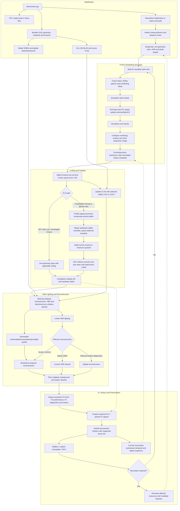

# Current Engine Pipeline

This diagram describes the implemented boulder renderer after Phase 4.1. F4 is the performance overlay and F5 contains interactive diagnostics. Phase 5 scene/material expansion, emissive area lighting, ReSTIR DI and SVGF are planned additions; multi-bounce GI is outside that phase.

Geometry targets, HDR/guide images and history use submission-owned frame slots; acquired swapchain-image indices protect output images, descriptors and command buffers separately. Normal rendering has no test-image readback or added device-idle wait. Frame-slot/image fences and Reflex scheduling may wait.

Exactly unchanged views use compatible previous depth in one pass. Moving/jittered views recover predicted-occluded meshlets before lighting; overflow fails open by rendering immediately. Hi-Z history is independent of optional temporal guides and lighting resets.

Native color does not accumulate previous color. DLAA/DLSS owns its reconstruction history; future ReSTIR reservoirs and SVGF lighting histories will require their own state and invalidation. The current visibility/material path is still tailored to the boulder.

See [file architecture](file.md), [verification and limits](file.md#verification-and-limits) and the [Phase 5 roadmap](roadmap.md).
