# Current Engine Pipeline

This diagram describes the shared pipeline for Boulder, both Lighting Sandbox layouts, Cornell Box, and Intel New Sponza (2022). It covers ReSTIR DI (48-byte packed cached surfaces, 32-byte reservoirs, emission payload caching), two-room sandbox with `0.53°` directional sunlight, native Vulkan **NVIDIA NRD (`v4.18.0`: `RELAX`, `REBLUR`, `SIGMA`)**, optional **DLSS 4.5 Ray Reconstruction (`preset F`)**, output-resolution emitter presentation (`present_emitters.comp.spv`), and Win32 NVIDIA Mailbox pre-present pacing. See [interfaces and validation](file.md#verification-and-limits). Lighting remains direct only (no GI or bounced light; custom SVGF stays deferred in favor of NRD).

```mermaid
flowchart TD
    subgraph Init["Initialization"]
        Main["demo/main.cpp"] --> VFS["VFS: engine.pak or loose files"]
        Main --> Runtime["Streamline initialization or native-only path"]
        Runtime --> Device["Vulkan instance/device and dispatch hooks"]
        Device --> Targets["Swapchain, two geometry slots, HDR, guide and NRD pools"]
        Main --> Assets["Preloaded boulder, benchmark and two-room sandbox GLBs"]
        Assets --> BLAS["Six LOD BLAS and scene TLAS"]
        Assets --> Bindless["Buffer-address model table and global materials/textures"]
    end

    subgraph CPU["Frame Scheduling and Input"]
        Targets --> Fence["Wait for reusable frame slot"]
        Fence --> Reflex["Frame token, Reflex options and scheduling sleep"]
        Reflex --> SimStart["Simulation-start marker"]
        SimStart --> Input["Poll input and PCL pings; update camera/object/UI"]
        Input --> SimEnd["Simulation-end marker"]
        SimEnd --> Acquire["Configure rendering/denoiser; acquire and retire swapchain image"]
        Acquire --> Frame["Current/previous transforms, jitter and depth-history metadata"]
    end

    subgraph Geometry["Culling and Visibility"]
        Frame --> Cull["Object frustum pre-cull and screen-space-error LOD"]
        Cull --> TLAS["Update all-instance TLAS with selected LOD or LOD 0"]
        Frame --> Lights["Prepare changed world-space triangle lights"]
        BLAS --> TLAS
        Cull --> Path{"Hi-Z path"}
        Path -->|"Off / warm-up / unchanged / frozen"| Single["One geometry pass with applicable culling"]
        Path -->|"Compatible moving or jittered view"| Predict["Predict against previous producing-camera depth"]
        Predict --> Initial["Raster predicted-visible meshlets; queue deferred meshlets"]
        Initial --> CurrentDepth["Build current reverse-Z minimum pyramid"]
        CurrentDepth --> Recover["GPU indirect recovery test and raster with attachment LOAD"]
        Single --> Visibility["Completed visibility IDs and hardware depth"]
        Recover --> Visibility
    end

    subgraph Lighting["HDR Lighting, Denoising and Reconstruction"]
        Visibility --> Deferred["Resolve instance/model/surface; PBR, sun or conventional/initial-RIS area lighting"]
        Lights --> Deferred
        Bindless --> Deferred
        TLAS --> Deferred
        Deferred --> HDR["Linear HDR; optional Native reference sum and mean"]
        Deferred --> TemporalDI["Initial candidates + temporal reuse (Basic fused); previous surface/light/TLAS"]
        TemporalDI --> SpatialDI["Scalar stable-pixel + general disocclusion reuse; Basic/reference correction"]
        TemporalDI -.-> TemporalHistory["Optional temporal-only history comparison"]
        SpatialDI --> FinalDI["Fresh final visibility and direct RGB (4-est for RR/RELAX; Basic fused)"]
        FinalDI --> HDR
        FinalDI -.-> HistoryDI["Retain final spatial reservoir for next frame by default"]
        Deferred --> Guides["Demanded temporal, RR and NRD guides (binding 31 normal/roughness, viewZ, 2.5D MV)"]
        FinalDI --> Demod["Optional NRD demodulated diffuse/specular + hit distance"]
        Deferred --> Demod
        Demod --> NRDCheck{"Effective NRD (mutually exclusive with RR)"}
        Guides --> NRDCheck
        NRDCheck -->|"RELAX / REBLUR / SIGMA"| NRD["Native Vulkan NRD v4.18.0 + nrd_compose.comp"]
        NRD --> HDR
        HDR --> Mode{"Effective reconstruction"}
        Guides --> SDK
        Guides --> RR
        Mode -->|"DLAA / DLSS K"| SDK["Streamline model K temporal reconstruction"]
        Mode -->|"DLSS 4.5 RR (preset F)"| RR["Streamline Ray Reconstruction (DLAA..Ultra Perf)"]
        Mode -->|"Native 100%"| Native["Current HDR directly"]
        Mode -->|"Reduced Native diagnostics"| Spatial["Spatial reconstruction"]
        SDK --> OptScale["Optional spatial scale: Off (100% -> 0 GPU/VRAM) or EASU/RCAS / Bilinear to Display"]
        RR --> OptScale
        OptScale --> Display["Tone mapping, background, viewport and optional output emitter resolve"]
        Native --> Display
        Spatial --> Display
    end

    subgraph Finish["UI, History and Presentation"]
        Display --> UI["Output-resolution F3 HUD, F4 performance, F5 diagnostics and menus"]
        UI --> FinalDepth["Finalize required Hi-Z / paired F2 capture"]
        Visibility -.-> FinalDepth
        FinalDepth --> Submit["Submit and present markers (pre-present fence sync on Win32 Mailbox)"]
        Submit --> Present["Mailbox (FSE disallowed) / explicit Immediate / FIFO"]
        Submit --> Commit["Commit successful-submission temporal and depth snapshots"]
        HistoryDI -.-> Commit
        TemporalHistory -.-> Commit
        Commit -.-> Frame
        Present --> Recreate{"Recreation required?"}
        Recreate -->|"Yes"| Reset["Recreate affected resources and invalidate histories"]
        Reset -.-> Targets
        Recreate -->|"No"| Fence
    end
```

Geometry targets, HDR/guide images, NRD inputs and history use submission-owned frame slots; acquired swapchain-image indices protect output images, descriptors and command buffers separately. Normal rendering has no test-image readback or added device-idle wait. On Win32 NVIDIA Mailbox swapchains, `VK_FULL_SCREEN_EXCLUSIVE_DISALLOWED_EXT` prevents tearing and `syncBeforeMailboxPresent` waits on the current frame's fence right before `vkQueuePresentKHR` so presentation runs on an idle 3D engine.

Exactly unchanged views use compatible previous depth in one pass. Moving/jittered views recover predicted-occluded meshlets before lighting; overflow fails open by rendering immediately. Hi-Z history is independent of optional temporal guides and lighting resets.

Ordinary Native does not blend previous color. Only the explicit unjittered reference accumulates sample sums to 4096 spp (including both area emitters and two-room directional sun). ReSTIR reuses samples independently of SDK/reference state. Final-spatial history restores repeated propagation; temporal-only history remains an optional comparison. For **DLSS 4.5 Ray Reconstruction**, final shading averages four normalized estimates (`75%` fresh RIS probability); for **NRD RELAX**, final shading averages four fresh visibility-tested RIS estimates and guides the diffuse filter with emitter distance. Extra final-shading draws stay out of reservoir history.

**NRD (`RELAX`, `REBLUR`, `SIGMA`)** and **DLSS 4.5 Ray Reconstruction** are mutually exclusive: selecting any RR mode forces effective NRD to `Off` and releases all NRD pools (`0 MiB`). When NRD is active, `nrd_compose.comp` remodulates denoised diffuse/specular irradiance (or composites SIGMA shadow visibility) into `temporal.color` before ordinary DLAA/DLSS SR or display tone mapping. When eligible, `present_emitters.comp.spv` (`emitter_presentation.glsl`) resolves visible area emitters at full output resolution via analytical pixel-coverage clipping after tone mapping/upscaling.

Basic material/initial generation and temporal reuse are fused; scalar stable-pixel and general disocclusion kernels fuse spatial reuse with final shading. Reference modes and ablations retain separate kernels. Current GPU records are 48 bytes per cached surface and 32 bytes per reservoir; retaining final output directly avoids a full-resolution history copy. Diagnostic shader variants and readback suites are opt-in and are absent from ordinary startup.

See [file architecture](file.md), [verification and limits](file.md#verification-and-limits) and the [roadmap](roadmap.md).
