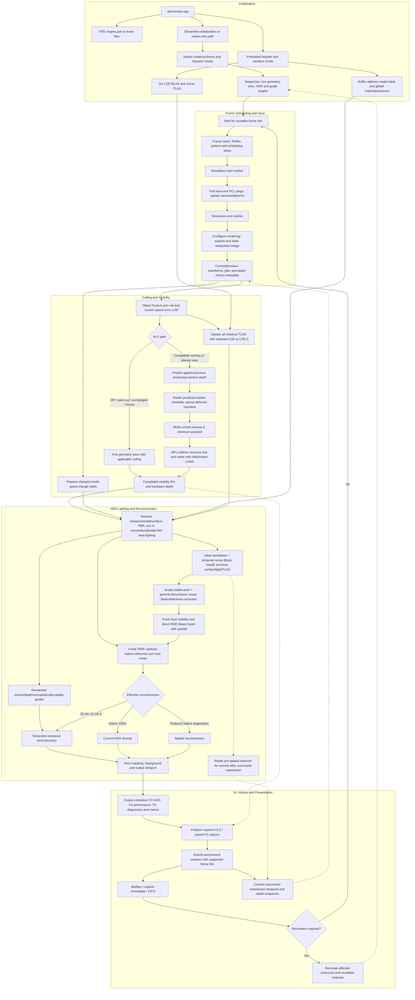

# Current Engine Pipeline

This diagram describes the implemented boulder and Phase 5 sandbox pipeline. ReSTIR DI has initial candidates, temporal reuse, spatial reuse and fresh final shadows, with Basic real-time or ray-traced reference correction. Phase 5 remains in progress: estimator/history validation and performance are open. See [interfaces and validation](file.md#verification-and-limits). There is no GI or production denoiser; RR follows in Phase 5.1 and SVGF stays deferred.

Geometry targets, HDR/guide images and history use submission-owned frame slots; acquired swapchain-image indices protect output images, descriptors and command buffers separately. Normal rendering has no test-image readback or added device-idle wait. Frame-slot/image fences and Reflex scheduling may wait.

Exactly unchanged views use compatible previous depth in one pass. Moving/jittered views recover predicted-occluded meshlets before lighting; overflow fails open by rendering immediately. Hi-Z history is independent of optional temporal guides and lighting resets.

Ordinary Native does not blend previous color. Only the explicit unjittered reference accumulates sample sums to 4096 spp. ReSTIR reuses samples independently of SDK/reference state. Pre-spatial history is an implementation workaround for unstable recursive feedback; it loses repeated spatial propagation and is not a general ReSTIR requirement. See [verification and limits](file.md#verification-and-limits).

Basic material/initial generation and temporal reuse are fused; scalar stable-pixel and general disocclusion kernels fuse spatial reuse with final shading. Reference modes and ablations retain separate kernels. Current GPU records are 80 bytes per cached surface and 32 bytes per reservoir; post-submission buffer rotation avoids a full-resolution history copy. Diagnostic shader variants and readback suites are opt-in and are absent from ordinary startup.

See [file architecture](file.md), [verification and limits](file.md#verification-and-limits) and the [Phase 5 roadmap](roadmap.md).
